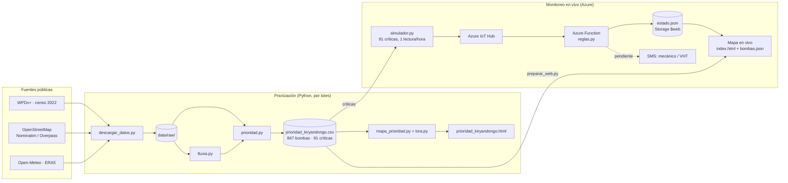
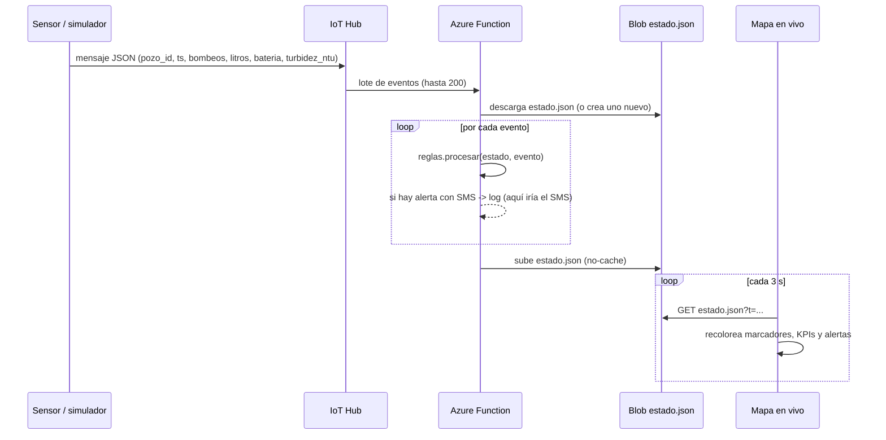

# Documentación del proyecto · Agua segura en Kiryandongo (Uganda)

Hackathon humanitario · BCG Team 2 · octubre 2026

Documento técnico y de proyecto: problema, requerimientos, stack, arquitectura, implementación, operación, gestión de riesgos y futuros pasos. Para el análisis de datos y las cifras de contexto, ver [`resumen_analisis.md`](resumen_analisis.md). Para instalar y correr, ver también el [`README.md`](../README.md).

---

## Índice

1. [Resumen](#1-resumen)
2. [Problema y contexto](#2-problema-y-contexto)
3. [Objetivos y alcance](#3-objetivos-y-alcance)
4. [Usuarios y casos de uso](#4-usuarios-y-casos-de-uso)
5. [Requerimientos](#5-requerimientos)
6. [Stack tecnológico](#6-stack-tecnológico)
7. [Arquitectura](#7-arquitectura)
8. [Modelo de datos](#8-modelo-de-datos)
9. [Implementación](#9-implementación)
10. [Despliegue y operación](#10-despliegue-y-operación)
11. [Pruebas y validación](#11-pruebas-y-validación)
12. [Presupuesto](#12-presupuesto)
13. [Gestión de riesgos](#13-gestión-de-riesgos)
14. [Limitaciones y problemas conocidos](#14-limitaciones-y-problemas-conocidos)
15. [Futuros pasos](#15-futuros-pasos)
16. [Fuentes y licencias](#16-fuentes-y-licencias)
17. [Glosario](#17-glosario)

---

## 1. Resumen

La herramienta dice **qué bombas de agua reparar, reforzar o monitorear primero** en el distrito de Kiryandongo, según cuántas personas afecta cada una. De **847 puntos de agua**, **91 son críticos** y concentran **41.295 personas afectadas**.

Tiene dos partes:

| Parte | Qué hace | Resultado |
|---|---|---|
| **Modelo de priorización** (v1, por reglas) | Clasifica cada bomba en Crítico / Alto / Revisar / Bien, calcula personas afectadas, pondera por estación seca y propone una red LoRaWAN para conectar sensores | `data/processed/prioridad_kiryandongo.csv` y `output/prioridad_kiryandongo.html` |
| **Monitoreo en vivo** (demo en Azure) | Simula sensores en las 91 bombas críticas, detecta posible falla, riesgo de contaminación y sobreuso, y muestra alertas en un mapa que se refresca cada 3 s | Sitio web estático en Azure Storage |

Despliegue actual del mapa en vivo: https://staguakiry27763.z1.web.core.windows.net/

---

## 2. Problema y contexto

- En Kiryandongo hay un asentamiento de **~165.000 refugiados** (Sudán del Sur y, desde 2023, Sudán). Dentro del asentamiento el agua bajó de **16 a 9 L/persona/día** entre 2023 y 2024; el mínimo humanitario es 15–20 L.
- Fuera del asentamiento, **~217.000 personas** dependen de bombas manuales con capacidad para **~170.000**. El **46%** de las bombas que funcionan está sobreusada; en **Bweyale** (pegado al asentamiento) el uso llega al **189%** de la capacidad.
- **112 bombas están rotas**; 49 de ellas dejaban sin agua a 300 personas o más cada una.
- El último censo de bombas es de **febrero de 2022** (The Water Trust, vía WPDx). Hoy nadie sabe cuáles funcionan.
- Las fallas se detectan tarde. En pilotos en Kenia, los sensores bajaron la reparación de **27 a 3 días**.
- **Hoy existen piezas sueltas** (WPDx prioriza por un criterio a la vez; charity: water y otros venden sensores por bomba; Sphere define umbrales), pero nadie las junta en un puntaje único con recomendación de inversión.

### Por qué Kiryandongo

Se compararon varias zonas de Uganda con WPDx. Kiryandongo tiene datos recientes y consistentes (847 puntos, censo 2022), una presión típica del 90% contra 25% en Gulu, y refugiados. El detalle está en [`resumen_analisis.md`](resumen_analisis.md#2-por-qué-kiryandongo).

---

## 3. Objetivos y alcance

### Objetivo

Decirle a una ONG o a un gobierno **dónde invertir primero**: qué bombas reparar, cuáles revisar y dónde poner sensores para que cada dólar evite la mayor cantidad de días-persona sin agua.

### Alcance del MVP (hackathon)

| Dentro del alcance | Fuera del alcance |
|---|---|
| Distrito de Kiryandongo, puntos de agua con dato 2016+ | Otros distritos (solo mapas exploratorios) |
| Disponibilidad: bombas rotas y sobreusadas | Calidad del agua medida (no hay datos de E. coli en Kiryandongo) |
| Ponderación por estación seca con lluvia histórica | Pronóstico de lluvia o sequía |
| Propuesta de red LoRaWAN (cobertura) | Diseño del sensor LoRa |
| Demo IoT con telemetría simulada en Azure | Sensores reales en terreno, envío real de SMS |
| Mapas HTML estáticos | Aplicación con usuarios, login o edición |

### Etapas

1. **Disponibilidad** (este MVP): bombas rotas o sobreusadas.
2. **Calidad del agua**: riesgo de contaminación (E. coli).
3. **Anticipación**: lluvia, sequía y probabilidad de falla.

---

## 4. Usuarios y casos de uso

**Usuario principal:** coordinador de agua de ACNUR, ONG socia u oficina distrital de agua.

**Usuarios secundarios:** mecánico de bombas (recibe alertas de falla), promotor de salud o VHT (recibe alertas de contaminación), comité de agua local.

| # | Caso de uso | Actor | Dónde |
|---|---|---|---|
| CU-1 | Ver qué bombas intervenir primero y por qué | Coordinador | Mapa de prioridad, top 20 |
| CU-2 | Filtrar por nivel del semáforo y por zona (distrito, cinturón del asentamiento, Bweyale) | Coordinador | Mapa de prioridad |
| CU-3 | Ver uso vs. capacidad de una zona | Coordinador | Panel "Zona" |
| CU-4 | Ver dónde instalar gateways LoRaWAN y cuántas bombas críticas quedan cubiertas | Coordinador / técnico | Capa "Red LoRaWAN" |
| CU-5 | Exportar el ranking completo | Coordinador | CSV (se abre en Excel) |
| CU-6 | Recibir aviso de que una bomba dejó de funcionar | Mecánico | SMS (simulado en logs) |
| CU-7 | Recibir aviso de posible contaminación tras lluvia | Promotor de salud | SMS (simulado en logs) |
| CU-8 | Ver el estado en vivo de las bombas monitoreadas | Coordinador | Mapa en vivo |

---

## 5. Requerimientos

### 5.1 Requerimientos funcionales

**Priorización**

| ID | Requerimiento | Estado |
|---|---|---|
| RF-01 | Descargar los datos desde fuentes públicas (WPDx, OpenStreetMap, Open-Meteo) | Hecho (`descargar_datos.py`) |
| RF-02 | Filtrar los puntos de Kiryandongo con reporte 2016 o posterior | Hecho |
| RF-03 | Normalizar el estado de cada punto (funciona, necesita reparación, rota, abandonada, contradictorio) | Hecho (`comun.categoria`) |
| RF-04 | Clasificar cada punto en Crítico / Alto / Revisar / Bien con reglas configurables | Hecho |
| RF-05 | Calcular personas afectadas: usuarios si está rota; exceso sobre 300 si está sobreusada | Hecho |
| RF-06 | Ponderar por estación seca (factor 1,0–1,2 según lluvia dic–feb) | Hecho |
| RF-07 | Ordenar por nivel y puntaje y exportar el ranking a CSV | Hecho |
| RF-08 | Mostrar un mapa con semáforo, popups con el motivo, top 20, lluvia y asentamiento | Hecho |
| RF-09 | Mostrar indicadores por zona (bombas, críticas, uso vs. capacidad) | Hecho |
| RF-10 | Proponer gateways LoRaWAN (torres existentes + nuevos) y calcular cobertura de críticas | Hecho (`lora.py`) |
| RF-11 | Recomendador de presupuesto (slider en USD) | Pendiente |

**Monitoreo en vivo**

| ID | Requerimiento | Estado |
|---|---|---|
| RF-20 | Simular telemetría horaria (bombeos, litros, batería, turbidez) para las 91 críticas | Hecho |
| RF-21 | Enviar la telemetría a Azure IoT Hub por un único dispositivo gateway | Hecho |
| RF-22 | Detectar posible falla: 3 horas diurnas seguidas sin bombeos | Hecho |
| RF-23 | Detectar riesgo de contaminación: turbidez > 5 NTU | Hecho |
| RF-24 | Detectar sobreuso: litros del día > 6.000 | Hecho (ver [problema conocido](#142-problemas-conocidos-del-mapa-en-vivo)) |
| RF-25 | Generar alertas con mensaje, y marcar cuáles van por SMS | Hecho |
| RF-26 | Enviar SMS reales al mecánico y al promotor de salud | Pendiente (hoy se registran en logs) |
| RF-27 | Mostrar el estado de cada bomba y las últimas alertas en un mapa que se refresca | Hecho |
| RF-28 | Funcionar igual en modo local (sin Azure) | Hecho (`--local`) |
| RF-29 | Detectar sensor caído (sin mensajes en 24 h) | Pendiente |
| RF-30 | Recibir reportes comunitarios por SMS (`KIR-0452 SI` / `NO`) | Pendiente |

### 5.2 Requerimientos no funcionales

| ID | Requerimiento | Cómo se cumple |
|---|---|---|
| RNF-01 | **Reproducible**: un comando regenera todo desde los datos versionados | `python src/correr_todo.py`; datos en `data/raw/` |
| RNF-02 | **Sin dependencias** para el pipeline principal | Solo librería estándar de Python |
| RNF-03 | **Transparente**: el usuario entiende por qué una bomba quedó primera | Reglas, no ML; cada popup muestra el motivo |
| RNF-04 | **Configurable**: los umbrales se cambian en un solo lugar | Constantes al inicio de `prioridad.py`, `lora.py` y `reglas.py` |
| RNF-05 | **Portable**: los resultados se ven sin instalar nada | Mapas HTML autocontenidos (solo necesitan internet para el fondo) |
| RNF-06 | **Consistencia**: la Function y el modo local dan el mismo resultado | Ambos importan `src/iot/reglas.py` |
| RNF-07 | **Bajo costo** en la demo | IoT Hub F1/S1, Functions en plan de consumo, sitio web estático |
| RNF-08 | **Latencia** del mapa en vivo | Refresco cada 3 s; `estado.json` con `cache-control: no-cache` |
| RNF-09 | **Seguridad** de credenciales | `.env` fuera del repo (`.gitignore`); secretos como app settings de la Function |
| RNF-10 | **Uso responsable de APIs públicas** | User-Agent identificado y pausas en Nominatim y Overpass |
| RNF-11 | **Adaptado al terreno** | Alertas por SMS (teléfonos básicos), no apps |
| RNF-12 | **Responsivo** | Los mapas se reorganizan bajo 800 px de ancho |

### 5.3 Requerimientos de entorno

| Para | Necesitas |
|---|---|
| Ver resultados | Un navegador con internet (teselas de OpenStreetMap y Leaflet desde unpkg) |
| Correr el pipeline | Python 3.9+ |
| Volver a descargar datos | Internet (WPDx, Nominatim, Overpass, Open-Meteo) |
| Demo IoT local | Python 3.9+ |
| Demo IoT en Azure | Suscripción de Azure, Azure CLI (o Azure Cloud Shell), `pip install azure-iot-device` |
| Desplegar la Function | Python 3.11 en Azure (lo instala el despliegue remoto) |

---

## 6. Stack tecnológico

| Capa | Tecnología | Versión | Por qué |
|---|---|---|---|
| Lenguaje | Python | 3.9+ (local), 3.11 (Function) | Equipo lo conoce; librería estándar alcanza |
| Datos | CSV y JSON | — | Se abren en Excel; sin base de datos |
| Descargas | `urllib` (stdlib) | — | Sin dependencias |
| Mapas | Leaflet | 1.9.4 (unpkg) | Liviano, sin build, funciona en un HTML suelto |
| Teselas | OpenStreetMap | — | Gratis, ODbL |
| Ingesta IoT | Azure IoT Hub | F1 (gratis) o S1 | Identidad por dispositivo, endpoint compatible con Event Hubs |
| Cliente IoT | `azure-iot-device` | — | SDK oficial para enviar mensajes al IoT Hub |
| Procesamiento | Azure Functions (Python, modelo v2) | Runtime 4, extension bundle `[4.*, 5.0.0)` | Trigger de Event Hubs, paga por uso |
| Almacenamiento | Azure Blob Storage | — | `estado.json` en el contenedor `$web` |
| Hosting web | Azure Storage, sitio web estático | — | Sin servidor; mismo origen que `estado.json` |
| Dependencias de la Function | `azure-functions`, `azure-storage-blob` | — | `azure/function_app/requirements.txt` |
| Despliegue | Bash + Azure CLI (`az`, extensión `azure-iot`) | — | Funciona en Azure Cloud Shell sin instalar nada |
| SMS (pendiente) | Africa's Talking o Twilio | — | Africa's Talking opera en Uganda |
| Control de versiones | Git + GitHub | — | `Alonsito1911/bcg-team-2` |

**Fuentes de datos:** WPDx+ (API Socrata, dataset `eqje-vguj`), OpenStreetMap (Nominatim y Overpass), Open-Meteo (archivo histórico ERA5).

---

## 7. Arquitectura

### 7.1 Vista general



**Idea central:** el CSV de prioridad es la única fuente de verdad sobre qué bombas existen y cuáles son críticas. El monitoreo en vivo toma de ahí las 91 que llevan sensor.

### 7.2 Flujo de la telemetría



### 7.3 Componentes

| Componente | Archivo | Responsabilidad | Entrada | Salida |
|---|---|---|---|---|
| Rutas y utilidades | `src/comun.py` | Rutas, normalización de estado, punto en polígono | — | — |
| Descarga | `src/descargar_datos.py` | Baja todos los datos crudos | APIs públicas | `data/raw/*` |
| Lluvia | `src/lluvia.py` | Lluvia diaria 2015–2024 en grilla de 0,1° | Open-Meteo | `lluvia_kiryandongo.json` |
| Modelo de prioridad | `src/prioridad.py` | Nivel, motivo, personas afectadas, factor seco, puntaje, ranking | WPDx, lluvia | `prioridad_kiryandongo.csv` |
| Red LoRaWAN | `src/lora.py` | Torres existentes + gateways nuevos (greedy), cobertura | CSV, antenas OSM | Resumen de cobertura |
| Mapa de prioridad | `src/mapa_prioridad.py` | HTML con datos embebidos | CSV, límites, lluvia, antenas | `prioridad_kiryandongo.html` |
| Orquestador | `src/correr_todo.py` | Corre datos → modelo → mapa | — | — |
| Exploración | `src/exploracion/*.py` | Mapas usados para elegir el distrito | `data/raw/` | `output/mapa_*.html` |
| Simulador | `src/iot/simulador.py` | Telemetría simulada; modo local o Azure | CSV, WPDx | Mensajes / `estado.json` local |
| Reglas | `src/iot/reglas.py` | Máquina de estados por bomba + alertas | Evento | Estado + alerta |
| Preparar web | `src/iot/preparar_web.py` | Copia `index.html` y arma `bombas.json` | CSV | `output/iot_web/` |
| Function | `azure/function_app/function_app.py` | Trigger de Event Hubs → reglas → blob | IoT Hub | `estado.json` |
| Mapa en vivo | `azure/web/index.html` | Mapa Leaflet que lee `estado.json` | `bombas.json`, `estado.json` | — |
| Despliegue | `azure/desplegar.sh` | Crea recursos y publica todo | `.env` | URL del mapa |

### 7.4 Estructura del repositorio

```
src/
  comun.py              Rutas y funciones compartidas
  correr_todo.py        Pipeline completo: datos -> modelo -> mapa
  descargar_datos.py    Baja data/raw/ desde las fuentes públicas
  lluvia.py             Lluvia histórica por celda (Open-Meteo)
  prioridad.py          Modelo de prioridad (umbrales al inicio)
  lora.py               Red LoRaWAN
  mapa_prioridad.py     Genera output/prioridad_kiryandongo.html
  exploracion/          Mapas para elegir el distrito
  iot/
    simulador.py        Sensores simulados (local o Azure)
    reglas.py           Reglas de detección (compartidas con la Function)
    preparar_web.py     Arma output/iot_web/
azure/
  desplegar.sh          Crea recursos y despliega
  function_app/         Azure Function (function_app.py, host.json, requirements.txt)
  web/index.html        Mapa en vivo
data/
  raw/                  Datos descargados (versionados)
  processed/            prioridad_kiryandongo.csv
output/                 Mapas HTML (output/iot_web/ no se versiona)
docs/                   Resumen del análisis y esta documentación
```

### 7.5 Decisiones de diseño

| Decisión | Alternativa descartada | Motivo |
|---|---|---|
| Reglas transparentes | Machine learning | Hay una sola foto (2022), sin historia para entrenar; el usuario debe entender el ranking |
| Solo librería estándar | pandas, geopandas, folium | Cualquiera lo corre sin instalar nada |
| HTML con datos embebidos | Servidor web / Streamlit | Se comparte como archivo; no hay que mantener un servidor |
| Un único dispositivo "gateway" en IoT Hub | Un dispositivo por bomba | Imita un gateway LoRa real; simplifica la demo |
| `estado.json` en blob | Base de datos | Lo lee directo el sitio estático; suficiente para 91 bombas |
| Reglas en un módulo compartido | Duplicarlas en la Function | El modo local y Azure dan exactamente el mismo resultado |
| Capacidad 300 personas por bomba | 250 (Sphere) o 500 | Es la que usa WPDx (`usage_cap`), y así `pressure` es coherente |
| Sensores celulares para el piloto | LoRaWAN desde el inicio | Probado en Uganda, costo similar a 91 bombas; LoRa conviene al escalar |

---

## 8. Modelo de datos

### 8.1 `data/processed/prioridad_kiryandongo.csv`

Una fila por punto de agua, ordenadas por `ranking`.

| Columna | Tipo | Descripción |
|---|---|---|
| `ranking` | int | 1 = más prioritaria |
| `wpdx_id` | str | Identificador WPDx |
| `lat`, `lon` | float | Coordenadas |
| `subcondado` | str | `clean_adm4` de WPDx |
| `estado` | str | `funciona`, `necesita_rep`, `rota`, `abandonada`, `contradictorio` |
| `status_clean` | str | Estado original de WPDx |
| `nivel` | str | `Crítico`, `Alto`, `Revisar`, `Bien` |
| `motivo` | str | Explicación legible (por ejemplo, "sobreusada al 392%") |
| `personas_afectadas` | int | Usuarios si está rota; exceso sobre la capacidad si está sobreusada |
| `personas_servidas` | int | `served_population` de WPDx (vacío si no hay dato) |
| `presion` | float | Uso / capacidad (`pressure` de WPDx) |
| `anio_instalacion` | int | Año de instalación |
| `fecha_reporte` | fecha | Fecha del último reporte |
| `lluvia_anual_mm` | int | Lluvia anual promedio de la celda |
| `lluvia_dic_feb_mm` | int | Lluvia de dic–feb de la celda |
| `factor_seco` | float | 1,0 a 1,2 |
| `puntaje` | float | `personas_afectadas × factor_seco` |

### 8.2 Mensaje de telemetría

```json
{
  "pozo_id": "6GHJX4HP+8J7",
  "codigo": "KIR-0002",
  "ts": "2026-10-17T10:00:00",
  "bombeos": 0,
  "litros": 0.0,
  "bateria": 0.937,
  "turbidez_ntu": 0.84
}
```

- `ts` es la hora simulada local de Kiryandongo.
- `litros` = bombeos × 0,4 L (supuesto para una India Mark II), con tope de 1.000 L/hora.

### 8.3 `estado.json`

```json
{
  "bombas": {
    "<pozo_id>": {
      "codigo": "KIR-0002", "estado": "posible_falla",
      "dia": "2026-10-17", "litros_dia": 3120.5, "horas_sin_uso": 3,
      "turbidez": 0.84, "bateria": 0.93, "ultimo": "2026-10-17T12:00:00"
    }
  },
  "alertas": [
    { "ts": "...", "pozo_id": "...", "codigo": "...", "tipo": "posible_falla",
      "anterior": "normal", "sms": true, "mensaje": "..." }
  ],
  "actualizado": "2026-10-17T12:00:00",
  "eventos": 728
}
```

Se guardan como máximo 200 alertas, la más nueva primero.

### 8.4 `bombas.json`

Lista de las 91 bombas críticas con `pozo_id`, `codigo`, `lat`, `lon`, `subcondado`, `usuarios` y `motivo`. La genera `preparar_web.py` desde el CSV.

### 8.5 Datos crudos (`data/raw/`)

| Archivo | Fuente | Uso |
|---|---|---|
| `wpdx_bunyoro_8.csv` | WPDx, 8 distritos de Bunyoro | Pipeline principal |
| `limites_bunyoro.json` | Nominatim (ids de relación fijos) | Límite del distrito |
| `settlement_Kiryandongo.json` | Nominatim | Límite del asentamiento |
| `lluvia_kiryandongo.json` | Open-Meteo | Factor seco y capa de lluvia |
| `antenas_osm_kiryandongo.json` | Overpass | Torres para gateways |
| `wpdx_gulu.csv`, `wpdx_mayuge.csv`, `wpdx_uganda_2024_2025.csv`, `wpdx_uganda_ecoli.csv`, `limite_gulu.json`, `limite_mayuge.json`, `settlement_Kyangwali.json` | WPDx / Nominatim | Exploración y modelos futuros |

Descargados el 16 de octubre de 2026.

---

## 9. Implementación

### 9.1 Pipeline de priorización

1. **Descarga** (`descargar_datos.py`): consultas SoQL a la API Socrata de WPDx, límites por id de relación de OpenStreetMap (reproducible), antenas por Overpass con un servidor de respaldo, y lluvia vía `lluvia.py`. Solo baja lo que falta, salvo con `--forzar`.
2. **Lluvia** (`lluvia.py`): grilla de 0,1° (~11 km) sobre la caja del distrito; lluvia diaria 2015–2024; promedio mensual y total anual por celda.
3. **Estado** (`comun.categoria`): si `status_clean` y `status_id` se contradicen, el punto queda como `contradictorio`.
4. **Clasificación** (`prioridad.clasificar`), en este orden:

| Condición | Nivel | Motivo | Personas afectadas |
|---|---|---|---|
| Abandonada o contradictoria | Revisar | "abandonada" / "estado contradictorio" | 0 |
| Sin `served_population` | Revisar | "sin dato de población" | 0 |
| `usage_cap` distinto de 300 | Revisar | "capacidad registrada atípica" | 0 |
| Rota con ≥ 300 usuarios | Crítico | "rota, deja sin agua a muchas personas" | usuarios |
| Rota con < 300 usuarios | Alto | "rota" | usuarios |
| Funciona con presión ≥ 200% | Crítico | "sobreusada al X%" | usuarios − 300 |
| Funciona con presión entre 100% y 200% | Alto | "sobreusada al X%" | usuarios − 300 |
| Resto | Bien | "funciona dentro de capacidad" | 0 |

5. **Factor seco**: `1 + 0,2 × (máx_seca − seca_celda) / (máx_seca − mín_seca)`, con la celda de lluvia más cercana.
6. **Puntaje y ranking**: `puntaje = personas_afectadas × factor_seco`; orden por nivel y luego por puntaje descendente.

**Umbrales** (inicio de `src/prioridad.py`):

| Constante | Valor | Significado |
|---|---|---|
| `ANIO_RECIENTE` | 2016 | Se ignoran reportes anteriores |
| `CAPACIDAD_BOMBA` | 300 | Personas por bomba manual |
| `ROTA_CRITICA_PERSONAS` | 300 | Rota crítica si deja sin agua a esta cantidad o más |
| `PRESION_CRITICA` | 2,0 | Sobreuso crítico (200%) |
| `PESO_SECO` | 0,2 | La zona más seca pesa hasta 20% más |
| `MESES_SECOS` | dic, ene, feb | Estación seca |

### 9.2 Red LoRaWAN (`lora.py`)

- Parte de las torres de OpenStreetMap, sin duplicados (torres a menos de 200 m = mismo sitio).
- Agrega `N_GATEWAYS_NUEVOS = 3` gateways con un algoritmo **greedy**: cada uno se ubica sobre la bomba crítica que cubre más personas afectadas todavía sin cobertura.
- Alcance `RADIO_LORA_KM = 10` (distancia haversine).
- Resultado con 10 km: 1 torre + 3 nuevos cubren **89 de 91** críticas.

| Alcance | Solo torre | + 3 nuevos | + 6 nuevos |
|---|---|---|---|
| 5 km | 23/91 | 62/91 | 79/91 |
| 7 km | 40/91 | 76/91 | 86/91 |
| 10 km | 54/91 | 89/91 | 91/91 |
| 15 km | 62/91 | 91/91 | 91/91 |

### 9.3 Mapa de prioridad (`mapa_prioridad.py`)

Plantilla HTML con los datos embebidos como JSON. Incluye:

- Máscara blanca fuera del distrito y límites fijos de navegación.
- Marcadores por nivel; el radio crece con las personas afectadas. "Bien" está oculto al inicio.
- Panel lateral: zonas (Distrito / Cinturón / Bweyale) con uso vs. capacidad, semáforo con conteos, gráfico de lluvia mensual, capas (lluvia dic–feb, asentamiento, red LoRaWAN) y top 20 clicable.

### 9.4 Simulador (`src/iot/simulador.py`)

- **Escenario:** las 91 críticas ya están reparadas y tienen sensor.
- **Día simulado:** desde las 05:00 del 17-10-2026, 16 horas por defecto.
- **Uso:** perfil por hora con picos a las 7–8 y 16–17 h; demanda = usuarios × 20 L × perfil, ±15% aleatorio, tope de 1.000 L/hora.
- **Eventos:**
  - **Falla:** la bomba #2 deja de bombear a las 10:00 (la alerta sale 3 horas diurnas después).
  - **Lluvia:** a las 13:00 la turbidez de los pozos poco profundos de Bweyale sube hasta ~18 NTU y baja exponencialmente durante 6 horas.
  - **Sobreuso:** surge solo, porque las críticas tienen más de 300 usuarios.
- **Opciones:** `--local` | `--azure`, `--horas 16`, `--pausa 1.0` (segundos reales por hora simulada), `--semilla 7`.

### 9.5 Reglas (`src/iot/reglas.py`)

Máquina de estados por bomba. Se evalúa en este orden; solo se genera una alerta cuando el estado cambia.

| Estado | Condición | SMS | Destinatario |
|---|---|---|---|
| `posible_falla` | ≥ 3 horas diurnas (06–19 h) seguidas sin bombeos | Sí | Mecánico |
| `riesgo_contaminacion` | Turbidez > 5 NTU | Sí | Promotor de salud: test de E. coli |
| `sobreuso` | Litros del día > 6.000 | No | — |
| `normal` | Ninguna | No | — |

Los litros del día se reinician cuando cambia la fecha de `ts`.

### 9.6 Azure Function (`azure/function_app/function_app.py`)

- Trigger `event_hub_message_trigger` sobre el endpoint compatible con Event Hubs del IoT Hub, con cardinalidad `MANY` y lotes de hasta 200 eventos (`host.json`).
- Por lote: descarga `estado.json`, aplica `reglas.procesar` a cada evento, registra los SMS como `warning` y sube el estado con `cache-control: no-cache`.
- `reglas.py` se copia junto a la Function al desplegar.

### 9.7 Mapa en vivo (`azure/web/index.html`)

- Carga `bombas.json` una vez y consulta `estado.json` cada 3 s.
- Colorea por estado: normal (verde), sobreuso (naranjo), riesgo de contaminación (azul), posible falla (rojo); los estados no normales se dibujan más grandes.
- Panel con hora simulada, mensajes procesados, conteo por estado y las 40 alertas con SMS más recientes.

---

## 10. Despliegue y operación

### 10.1 Correr localmente

```bash
# Priorización
python src/correr_todo.py                 # datos -> modelo -> mapa
python src/correr_todo.py --exploracion   # además, los mapas de exploración
python src/descargar_datos.py --todo --forzar   # volver a bajar todo

# Monitoreo en vivo sin Azure
python src/iot/preparar_web.py
python src/iot/simulador.py --local --pausa 2
python -m http.server -d output/iot_web 8000    # http://localhost:8000
```

### 10.2 Desplegar en Azure

Desde https://shell.azure.com (Bash):

```bash
git clone https://github.com/Alonsito1911/bcg-team-2.git && cd bcg-team-2
RG=SANTIAGO-team-2 HUB_SKU=S1 bash azure/desplegar.sh   # suscripción de la hackathon
pip install --user azure-iot-device
python3 src/iot/simulador.py --azure --pausa 3
```

El script hace 6 pasos, y cada uno reutiliza lo que ya existe:

1. Grupo de recursos (usa el existente y su región si ya está).
2. IoT Hub (`F1` o `S1`) y dispositivo `gateway-kiryandongo`.
3. Storage con sitio web estático.
4. Function App (plan de consumo Linux; si falla, Flex Consumption) y app settings.
5. Código de la Function (zip con build remoto).
6. Mapa en vivo: `index.html`, `bombas.json` y un `estado.json` vacío.

### 10.3 Configuración

| Variable | Dónde | Descripción |
|---|---|---|
| `RG`, `LOC`, `HUB`, `HUB_SKU`, `ST`, `FN` | `.env` / entorno | Nombres de recursos (por defecto con sufijo aleatorio) |
| `IOTHUB_DEVICE_CONNECTION_STRING` | `.env` | La usa el simulador en modo `--azure` |
| `IOTHUB_EVENTS` | App setting | Conexión al endpoint de eventos del IoT Hub |
| `IOTHUB_EVENTHUB_NAME` | App setting | Nombre de ese endpoint |
| `WEB_STORAGE` | App setting | Conexión al Storage del sitio web |

`.env` está en `.gitignore`. No se sube al repo.

### 10.4 Restricciones de la suscripción de la hackathon

- No se pueden crear grupos de recursos: usar `RG=SANTIAGO-team-2`. **No borrar ese grupo.**
- El IoT Hub F1 ya está ocupado y la política "Hackathon Cost Limits" solo permite F1 o S1: usar `HUB_SKU=S1`.
- Para limpiar, borrar solo `iot-agua-kiry-*`, `staguakiry*` y `fn-agua-kiry-*`.

### 10.5 Monitoreo y diagnóstico

| Síntoma | Revisar |
|---|---|
| El mapa en vivo no cambia | Que el simulador esté enviando; logs de la Function (Application Insights / Log stream); que `estado.json` se actualice en `$web` |
| La Function no se dispara | App settings `IOTHUB_EVENTS` e `IOTHUB_EVENTHUB_NAME` |
| El mapa muestra estados de una corrida anterior | `estado.json` acumula; subir un `estado.json` vacío (paso 6 del script) |
| `desplegar.sh` dice "Listo" pero algo falló (Windows) | Usar `python -m azure.cli`; el script ya lo hace si `az` no está en el PATH |

---

## 11. Pruebas y validación

| Qué | Cómo | Resultado |
|---|---|---|
| Reproducibilidad del pipeline | Descarga desde cero el 16-10-2026 y comparación con `data/raw/` | Resultados idénticos |
| Consistencia entre mapas | Comparar `bombas.json` con el CSV | Mismas 91 bombas, mismos ids y coordenadas |
| Reglas IoT | Corrida `--local` con semilla 7 | Alertas de falla (#2) y de contaminación en Bweyale; 90 de 91 bombas terminan en sobreuso (ver 14.2) |
| Despliegue | `desplegar.sh` en la suscripción de la hackathon | Funcionando (commit `863a4d5`) |
| Totales del modelo | Conteos por nivel impresos por `prioridad.py` | 91 / 284 / 104 / 368 |

**No hay pruebas automatizadas.** Ver futuros pasos.

**Validación pendiente:** ranking contra la opinión de la oficina distrital de agua y verificación en terreno de las 91 críticas.

---

## 12. Presupuesto

Las cifras marcadas con ⚠️ son órdenes de magnitud sin cotizar. El detalle está en [`resumen_analisis.md`](resumen_analisis.md#9-presupuesto-para-las-91-bombas-críticas).

| Escenario | Costo | Resultado |
|---|---|---|
| A. Solo sensores (celular) | ~17–25 mil USD | Monitoreo de las 91 críticas |
| **B. Sensores + reparar las 49 rotas** | **~22–50 mil USD** ⚠️ | **~22.000 personas recuperan el agua (~1–2 USD por persona)** |
| C. B + pozos nuevos | ~0,5–1 millón USD ⚠️ | Además, se resuelve el sobreuso de 19.537 personas |

Al escalar a las 847 bombas: celular ~212 mil USD, LoRa ~109 mil USD ⚠️.

**Recomendación:** celular para el piloto (probado, mismo costo) y LoRa al escalar.

---

## 13. Gestión de riesgos

### 13.1 Escala

- **Probabilidad:** Baja (poco probable en el piloto), Media (puede pasar), Alta (es probable o ya pasa).
- **Impacto:** Bajo (molestia), Medio (retrasa o distorsiona decisiones), Alto (decisiones equivocadas o personas sin agua).

### 13.2 Registro de riesgos

| ID | Riesgo | Área | Prob. | Impacto | Mitigación | Plan de contingencia |
|---|---|---|---|---|---|---|
| R-01 | El censo WPDx es de feb. 2022; el estado real cambió | Datos | Alta | Alto | Verificar en terreno las 91 críticas antes de reparar | Re-priorizar con lo verificado; los sensores actualizan el estado en adelante |
| R-02 | WPDx subcuenta a los refugiados (~16.000 contra ~165.000) | Datos | Alta | Medio | Cruzar con ACNUR y UNICEF | Enfocar el piloto fuera del asentamiento, donde el dato es mejor |
| R-03 | Límite del asentamiento en OSM incompleto | Datos | Media | Bajo | Pedir el límite oficial a ACNUR | Usar el subcondado como proxy |
| R-04 | Umbrales no calibrados (300 vs. 250 de Sphere) | Modelo | Media | Medio | Umbrales en un solo archivo; validar con la oficina distrital | Correr un análisis de sensibilidad con 250 y 500 |
| R-05 | El sobreuso domina el mapa en vivo (90 de 91 en naranjo) | Modelo | Alta | Medio | Comparar el uso contra la línea base de cada bomba | Ocultar el sobreuso en la demo y mostrar solo falla y contaminación |
| R-06 | Sin datos de E. coli en Kiryandongo | Datos | Alta | Alto | La turbidez solo dispara un test (kit de bolsa, ~10 USD) | Entrenar con los 1.506 puntos de WPDx Uganda como riesgo relativo |
| R-07 | Se apagan las redes 2G/3G de los sensores celulares | Tecnología | Media | Alto | Confirmar con MTN y Airtel | Migrar a LoRaWAN o a sensores 4G/LTE-M |
| R-08 | El alcance LoRa real es menor que 10 km | Tecnología | Media | Medio | Prueba de campo de un día | Con 7 km: 6 gateways nuevos cubren 86/91 |
| R-09 | Antenas de OSM muy incompletas (1 sitio en el distrito) | Datos | Alta | Bajo | Usar OpenCelliD | El error es conservador: hay más torres, no menos |
| R-10 | No existe un sensor LoRa listo para bombas manuales | Tecnología | Alta | Medio | Piloto con sensores celulares existentes | Desarrollar o adaptar un sensor antes de escalar |
| R-11 | Costos sin cotizar (reparaciones, pozos, gateways) | Presupuesto | Media | Alto | Cotizar en Uganda; presentar rangos | Empezar por el escenario A, que tiene el costo más firme (~250 USD por sensor) |
| R-12 | Varias instancias de la Function sobrescriben `estado.json` | Tecnología | Baja (demo) / Alta (producción) | Medio | Una instancia en la demo | Estado por bomba en Table Storage, con concurrencia optimista |
| R-13 | Las alertas SMS no llegan: falta el proveedor | Operación | Alta | Alto | Conectar Africa's Talking | Llamada de voz o reporte diario por correo a la oficina distrital |
| R-14 | Muchas mujeres, que acarrean el agua, no tienen celular (64%) | Adopción | Alta | Alto | Bandera roja en la bomba, promotor de salud, radio, iglesias | Aviso casa por casa del VHT |
| R-15 | Nadie actúa sobre la alerta (mecánico sin repuestos o sin presupuesto) | Adopción | Media | Alto | Acordar tiempos de respuesta; modelo M4W de Masindi (mecánico en 48 h) | Escalar a la oficina distrital si la alerta no se cierra en X días |
| R-16 | Vandalismo o robo de sensores | Operación | Media | Medio | Sensor dentro del cabezal; involucrar al comité de agua | Reponer con un stock de 5–10% |
| R-17 | Falsos positivos de falla (bomba sin uso por feriado o lluvia) | Modelo | Media | Medio | Exigir 3 horas diurnas; ajustar con datos reales | Confirmación por SMS del cuidador antes de enviar al mecánico |
| R-18 | Credenciales expuestas (`.env`, cadenas de conexión) | Seguridad | Baja | Alto | `.env` en `.gitignore`; app settings | Rotar las claves del IoT Hub y del Storage |
| R-19 | Límites de la suscripción de la hackathon (SKU, grupos) | Tecnología | Alta | Bajo | Script parametrizado (`RG`, `HUB_SKU`) | Desplegar en otra suscripción con `desplegar.sh` |
| R-20 | Cambios en las APIs públicas (WPDx, Overpass) | Datos | Baja | Bajo | Datos versionados en `data/raw/` | Usar los archivos versionados |
| R-21 | Datos personales en reportes comunitarios por SMS | Seguridad | Media | Medio | Guardar solo el código del pozo y el resultado | Anonimizar los números de teléfono |

### 13.3 Mapa de calor

| Probabilidad \ Impacto | Bajo | Medio | Alto |
|---|---|---|---|
| **Alta** | R-09, R-19 | R-02, R-05, R-10 | **R-01, R-06, R-13, R-14** |
| **Media** | R-03 | R-04, R-08, R-16, R-17, R-21 | **R-07, R-11, R-15** |
| **Baja** | R-20 | R-12 | R-18 |

Los riesgos de la esquina superior derecha se atienden antes del piloto de campo.

### 13.4 Seguimiento

- Revisar el registro al cierre de cada etapa (demo, piloto, escala).
- Cada riesgo Alto/Alto tiene un responsable asignado antes del piloto.
- Se registran los riesgos nuevos que aparezcan en terreno.

---

## 14. Limitaciones y problemas conocidos

### 14.1 Limitaciones de datos y modelo

- **Los datos son una foto de febrero de 2022**, en plena estación seca de un año seco.
- **WPDx subcuenta a los refugiados** y no incluye los sistemas motorizados con grifos de 2025 dentro del asentamiento.
- **Los umbrales no están calibrados.**
- **No hay datos de calidad del agua** en Kiryandongo.
- **Las antenas de OpenStreetMap están muy incompletas.**
- **Los costos marcados ⚠️ son órdenes de magnitud.**

### 14.2 Problemas conocidos del mapa en vivo

Los datos del mapa en vivo y del mapa de prioridad coinciden (las mismas 91 bombas, ids y coordenadas), pero se ven distintos:

| # | Problema | Causa | Arreglo propuesto |
|---|---|---|---|
| 1 | Muestra 91 bombas, no 847 | El simulador solo toma las críticas | Mostrar las otras 756 en gris como contexto |
| 2 | Los colores significan otra cosa | Mapa de prioridad = nivel; mapa en vivo = estado del sensor | Leyenda explícita; incluir el nivel en el popup |
| 3 | 90 de 91 bombas terminan en "sobreuso" | Toda bomba crítica tiene más de 300 usuarios y 300 × 20 L = 6.000 L es el umbral fijo | Comparar contra la línea base de cada bomba (por ejemplo, +20%) |
| 4 | Las 49 rotas aparecen funcionando | El escenario supone que ya se repararon | Decirlo en el panel |
| 5 | Códigos distintos (`KIR-0002` vs. `#2`) | Formatos distintos en cada mapa | Usar `#ranking` y el motivo en ambos |
| 6 | Sin límite del distrito ni asentamiento | `index.html` no los carga | Agregarlos a `bombas.json` o a un `contexto.json` |

---

## 15. Futuros pasos

### Corto plazo (demo)

- [ ] Arreglar los 6 problemas del mapa en vivo (sección 14.2), sobre todo el umbral de sobreuso.
- [ ] Conectar el envío real de SMS (Africa's Talking o Twilio).
- [ ] Regla de sensor caído (sin mensajes en 24 h).
- [ ] Recomendador de presupuesto en el mapa: slider en USD → bombas a reparar y monitorear, personas que recuperan el agua.
- [ ] Pruebas automatizadas de `prioridad.clasificar`, `lora.escenario` y `reglas.procesar`.

### Mediano plazo (piloto en Kiryandongo)

- [ ] Verificar en terreno las 91 bombas críticas.
- [ ] Cotizar en Uganda reparaciones, pozos nuevos, sensores y gateways.
- [ ] Instalar sensores celulares (India Mark II de charity: water, ~250 USD) y reparar las 49 rotas.
- [ ] Prueba de campo de un día para medir el alcance LoRa real.
- [ ] Antenas reales con OpenCelliD.
- [ ] Reporte comunitario por SMS (`KIR-0452 SI` / `NO`) con códigos pintados en cada bomba.
- [ ] Estado por bomba e historial en Table Storage.
- [ ] Acuerdo de respuesta con la oficina distrital y los mecánicos.

### Largo plazo (escala)

- [ ] Modelo de probabilidad de falla con ~98.000 puntos de WPDx Uganda.
- [ ] Modelo de riesgo de contaminación con los 1.506 puntos con resultado de E. coli.
- [ ] Escalar a las 847 bombas con LoRaWAN.
- [ ] Replicar en otros distritos con refugiados (por ejemplo, Kyangwali, que en 2022 tenía 36% de bombas rotas).
- [ ] Integrar los sistemas motorizados del asentamiento (cloro residual, turbidez).

---

## 16. Fuentes y licencias

| Dato | Fuente | Licencia |
|---|---|---|
| Puntos de agua | [WPDx+](https://www.waterpointdata.org), dataset `eqje-vguj` | CC BY 4.0 |
| Límites de distritos y asentamientos | OpenStreetMap vía [Nominatim](https://nominatim.openstreetmap.org) | ODbL |
| Antenas y torres | OpenStreetMap vía [Overpass](https://overpass-api.de) | ODbL |
| Lluvia diaria 2015–2024 | [Open-Meteo](https://open-meteo.com), reanálisis ERA5 | CC BY 4.0 |

Las cifras de contexto (UNICEF, OMS, UDHS 2022, Sphere, charity: water) están enlazadas en [`resumen_analisis.md`](resumen_analisis.md).

---

## 17. Glosario

| Término | Significado |
|---|---|
| **WPDx** | Water Point Data Exchange: base pública de puntos de agua |
| **Presión** (`pressure`) | Usuarios / capacidad de la bomba |
| **Personas afectadas** | Usuarios de una bomba rota, o exceso sobre la capacidad de una sobreusada |
| **Factor seco** | Peso de 1,0 a 1,2 según lo poco que llueve en dic–feb |
| **India Mark II, Afridev, Consallen** | Modelos de bomba manual |
| **Pozo poco profundo** | Pozo excavado o somero; se seca y se contamina más |
| **NTU** | Unidad de turbidez; la guía de la OMS es 5 NTU |
| **LoRaWAN** | Red de radio de bajo consumo y largo alcance para sensores |
| **Gateway** | Antena que recibe los mensajes LoRa y los envía a internet |
| **IoT Hub** | Servicio de Azure que recibe mensajes de dispositivos |
| **VHT** | Village Health Team: promotor de salud comunitario |
| **Sphere** | Estándares mínimos humanitarios (15 L/persona/día, 500 m, 30 min) |
| **Cinturón** | Subcondados Bweyale y Kiryandongo, alrededor del asentamiento |
