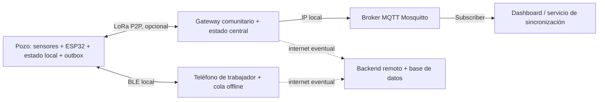
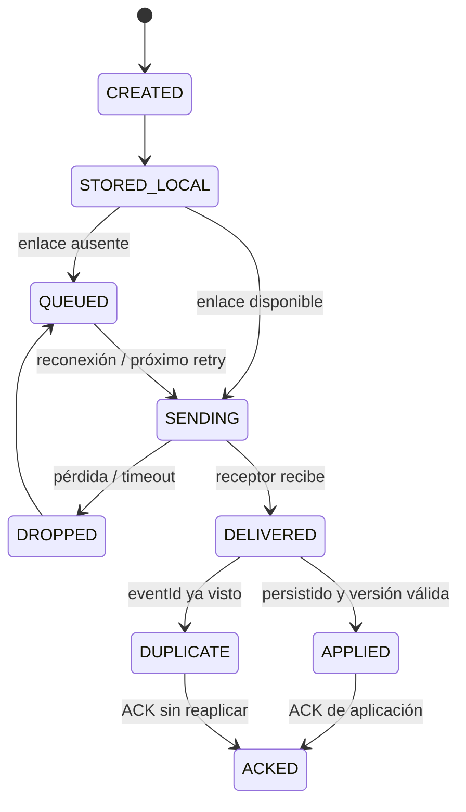

# WaterLight — Especificación funcional, reglas de negocio y simulación

**Versión:** 1.0 · **Tipo:** contrato de implementación para agente de desarrollo · **Contexto:** hackathon de seguridad hídrica en comunidades rurales de Turkana (Kenia) y norte de Uganda.

> **INSTRUCCIÓN PARA EL AGENTE:** Construye una **demo interactiva real y ejecutable**, no una presentación estática ni un mockup. Lee este documento junto con `02_UX_UI_Y_ASSETS.md`. Ambos son vinculantes: este define las reglas y el segundo define cómo se muestran. La demo debe poder ejecutarse localmente en un navegador sin servicios externos. Usa los cuatro diseños de `refs/` como referencias visuales, pero no copies inconsistencias funcionales que puedan aparecer en las ilustraciones.
>
> **IMPORTANTE:** Todo dato de contaminación, seguridad del agua, sensor, cobertura, latencia y número de habitantes de esta demo es **simulado**. No presentar sus resultados como diagnóstico real ni como certificado de potabilidad. El concepto está pensado para apoyar a trabajadores comunitarios y evaluaciones sanitarias válidas, nunca para reemplazarlas.

---

## 0. Qué se entrega y cuándo se considera terminado

La experiencia reproduce **un único pueblo**, **exactamente tres pozos**, **un semáforo físico central**, **2–4 habitantes** y **un trabajador comunitario**. El operador del hackathon modifica estados o parámetros, el motor crea eventos y simula movimiento, detección, transmisión de alertas, recepción/ACK, cambio de semáforo y decisiones de los habitantes. Al pulsar un pozo se abre un detalle con **su arquitectura de comunicación** y una mini demo interactiva de fallas y recuperación.

**Entregables funcionales obligatorios:**

1. Vista de pueblo con tres pozos separados alrededor, chozas, caminos, habitantes y semáforo central.
2. Controles rápidos por pozo: **Habilitado**, **Sin agua (volumen)**, **Contaminado**, **Daño de válvula**.
3. Modo de detalle para editar factores subyacentes (volumen, prueba de contaminación, válvula, vigencia, conectividad) sin confundir el estado resultante.
4. Motor de reglas determinista, no cambios cosméticos independientes del estado real.
5. Decisión automática o manual sobre **a qué pozo irán las personas** y animación de su desplazamiento.
6. Un flujo humano: persona descubre un problema, **lo reporta**; un trabajador lo verifica y publica la información mediante un enlace disponible.
7. Transmisión animada por capas: dispositivo del pozo → radio P2P/LoRa → gateway/semáforo central → MQTT (si hay red IP) → servidor/panel remoto. También ruta alternativa trabajador → BLE → dispositivo o sincronización transportada.
8. Interruptores de pérdida de conexión, paquetes perdidos, apagado del gateway y vuelta de internet con cola persistente, reintentos, confirmaciones y resolución de mensajes duplicados o antiguos.
9. Indicadores visibles de **estado sanitario/operacional**, **conectividad**, **última actualización**, **frescura del dato** y **mensaje pendiente**; nunca confundir estos conceptos.
10. Presets de escenarios de demo, controles Play/Pause/Paso a paso/Reset y cronología de eventos legible.
11. Arquitectura ampliable al tocar un pozo con una mini simulación de **un solo mensaje** (éxito, pérdida, almacenamiento, reintento y confirmación).
12. Pruebas automatizadas de las reglas críticas y funcionamiento offline de la demo.

**No construir:** mapa mundial, cientos de pozos, dashboard empresarial grande, autenticación real, pagos, GIS real, sensores físicos en producción, ML predictivo, laboratorio químico ficticio, servidor permanente requerido para la demo, ni una red LoRa real durante el hackathon.

---

## 1. Contexto y actores

**Problema representado:** Las personas no siempre disponen de información clara, actualizada y accesible sobre el estado de un punto de agua. Algunos fallos son operacionales (falta de volumen, bomba/válvula dañada); otros son sanitarios (contaminación confirmada o sospechada). Las condiciones de conectividad pueden impedir que una advertencia llegue a tiempo.

**Actores:**

| Actor | Qué sabe | Qué hace | Restricción |
| --- | --- | --- | --- |
| Habitante (mujer o niño/a representativo) | Señales físicamente visibles en pueblo/pozo | Busca un punto habilitado, recoge agua; puede observar y reportar una anomalía | No tiene por qué poseer teléfono ni conocimientos técnicos |
| Trabajador/a comunitario/a | Resultados e inspecciones | Visita pozo, registra evidencia, confirma y transmite un cambio autorizado | Puede no tener internet |
| Operador de demo | Todos los parámetros simulados | Desencadena fallos, elige personaje/pozo, inicia o pausa | Su control es **modo simulación**, no una acción sanitaria real |
| Pozo inteligente simulado | Estado local, sensores y pruebas recibidas | Muestra su condición; almacena y transmite eventos | No depende de la nube para su indicación local |
| Gateway/semáforo central | Último estado **recibido** de cada pozo | Agrega estados, informa y enruta eventos | Puede quedar aislado, apagarse o estar desactualizado |
| Broker/servidor | Eventos entregados y sincronizados | Consolida histórico, muestra supervisión | No puede inventar eventos de pozos aislados |

Las personas no deben ser caricaturizadas como incapaces. El foco está en la infraestructura y en ampliar la capacidad de comunicación de la comunidad.

---

## 2. Modelo de datos y distinciones obligatorias

### 2.1 Cuatro estados principales del pozo

El operador debe poder forzar estos estados de forma inmediata en modo «Cambio rápido»:

| ID interno | UI en español | Color/chip | Interpretación | ¿Apto para ruta de recolección? |
| --- | --- | --- | --- | --- |
| `ENABLED` | Habilitado | Verde | Volumen suficiente, mecanismo utilizable y verificación sanitaria simulada vigente | Sí |
| `NO_WATER` | Sin agua | Ámbar oscuro / símbolo gota vacía | Volumen por debajo del mínimo operativo | No |
| `CONTAMINATED` | Contaminado | Rojo / prohibición | Contaminación confirmada **por resultado simulado de prueba válida** | No |
| `VALVE_DAMAGE` | Daño de válvula | Ámbar / llave rota | No se puede extraer agua normalmente, aunque haya volumen | No |

**Estado adicional de seguridad, no uno de los cuatro botones de la demo:** `UNKNOWN` = «Sin verificar / información vencida». No equivale a agua limpia ni autoriza recolectar. Se activa cuando faltan verificaciones, un dispositivo no puede demostrar que la autorización es vigente o hay sospecha aún sin confirmar. Es necesario evitar que una muestra desconocida produzca una señal verde falsa.

**Subestado opcional sin crear quinto botón:** `LOW_RESERVE` («Reserva baja»), cuando todavía hay volumen utilizable pero queda poca agua. Se muestra como advertencia secundaria sobre un pozo `ENABLED`, no como «Sin agua». Se permite reservar el pozo solo si supera el mínimo operacional.

### 2.2 Factores independientes que producen el estado

Cada pozo es un objeto con:

- `waterVolumePct` de 0 a 100.
- `valveCondition`: `OK` / `DAMAGED`.
- `waterTest`: `VALID_NEGATIVE` / `CONFIRMED_POSITIVE` / `PENDING` / `MISSING` / `EXPIRED` (datos **ficticios**).
- `reportedAnomaly`: `NONE` / `SUSPECTED` (por olor, color extraño, entorno dañado u observación; **no confirma contaminación**).
- `testValidUntil` y `testVerifiedBy` (fuente y vigencia).
- `sensorTelemetry` opcional: `turbidity`, `temperature`, `conductivity`, `batteryPct` como datos simulados. Ninguno prueba por sí solo ausencia de E. coli ni de fluoruro.
- `wellPowered`, `lastLocalUpdate`, `lastCentralReceived`, `version`, `outbox`, `lastEventId`.
- `wellToGatewayLink`: disponible/no disponible, `latencyMs`, `packetLossPct`.
- `phoneToWellLink`: BLE disponible/no disponible (distancia lógica simulada).

El estado debe ser **DERIVADO** del modelo, no una variable libre separada que se desincroniza con los factores. Para permitir cambios rápidos, el botón activa un **preset atómico de factores**; el motor recalcula entonces el estado.

### 2.3 Umbrales de demo, editables y claramente simulados

Constantes iniciales (no son recomendaciones de salud, hidráulica ni valores oficiales):

```ts
const DEMO_CONFIG = {
  dryVolumeThresholdPct: 15,       // por debajo de 15% = NO_WATER
  lowReserveThresholdPct: 35,      // 15–34% = ENABLED + LOW_RESERVE
  minCollectibleVolumePct: 15,
  demoPacketLossPct: 0,
  demoLoRaLatencyMs: 900,          // SOLO visualización, no cifra de desempeño real
  demoBleLatencyMs: 350,
  demoGatewayToCloudLatencyMs: 700,
  retryDelaysMs: [1500, 3000, 6000, 10000],
  simulationSpeed: 1,
  demoFreshnessWarningSeconds: 25 // SOLO para acelerar pruebas de UI
};
```

**Vigencia del control sanitario:** modelarla como una propiedad aparte y configurable para el sitio/punto de agua. **No** afirmar que en la vida real el análisis caduca a los 25 segundos. La marca de frescura en segundos solo acelera escenarios pedagógicos de comunicación.

### 2.4 Precedencia del motor de estados

La siguiente función es la fuente de verdad **para la demo**:

```ts
function deriveWellState(well): WellState {
  if (well.waterTest === 'CONFIRMED_POSITIVE') return 'CONTAMINATED';
  if (well.valveCondition === 'DAMAGED') return 'VALVE_DAMAGE';
  if (well.waterVolumePct < config.dryVolumeThresholdPct) return 'NO_WATER';
  if (well.reportedAnomaly === 'SUSPECTED') return 'UNKNOWN';
  if (well.waterTest !== 'VALID_NEGATIVE' || well.testIsExpired) return 'UNKNOWN';
  return 'ENABLED';
}
```

Notas importantes:

- Si hay simultáneamente contaminación y válvula dañada, mostrar `CONTAMINATED` como etiqueta principal y **ambos problemas** en el detalle. No descartar fallos secundarios.
- `UNKNOWN` no equivale a contaminado; su indicación pública debe ser «No asumir potable / pendiente de verificación».
- La ausencia de alertas de sensores no crea `VALID_NEGATIVE`. Solo una prueba/validación autorizada, dentro del protocolo del pozo, podría respaldar un estado verde. En el prototipo esto se **simula**.
- Un pozo sin electricidad conserva su último registro en la memoria, pero el indicador físico simulado debe mostrar **señal pasiva de precaución** o apagado identificado; nunca mantener un verde engañoso.
- En modo avanzado el estado principal resulta de condiciones combinables. En modo rápido un preset **restablece los demás factores a una condición inicial conocida** antes de aplicar el fallo seleccionado; mostrar «Preset reemplaza factores anteriores».

### 2.5 Presets del modo rápido

| Pulsación | Actualizaciones atómicas simuladas |
| --- | --- |
| Habilitado | volumen=80, válvula=OK, prueba=VALID_NEGATIVE vigente, sospecha=NONE |
| Sin agua | volumen=0, válvula=OK, prueba=VALID_NEGATIVE vigente, sospecha=NONE |
| Contaminado | volumen=80, válvula=OK, prueba=CONFIRMED_POSITIVE (simulada), sospecha=NONE |
| Daño de válvula | volumen=80, válvula=DAMAGED, prueba=VALID_NEGATIVE vigente, sospecha=NONE |

La interfaz debe distinguir «configurar un escenario desde panel de control» de «un habitante detectó un problema en el mundo de la simulación». El operador cambia factores inmediatamente; el **evento y la propagación al semáforo central** siguen el canal de comunicación realmente disponible.

---

## 3. El semáforo central: regla de agregación

**No representa que toda el agua del pueblo tenga la misma calidad.** Representa el estado operativo de acceso del pueblo respecto de los tres pozos y debe acompañarse de la lista individual. Un pozo contaminado **no convierte automáticamente los otros pozos en contaminados**.

| Color central | Condición | Mensaje breve |
| --- | --- | --- |
| Verde | Los **3 pozos** tienen última información recibida vigente, son `ENABLED` sin reservas críticas y no hay advertencias activas | «3 puntos disponibles» |
| Amarillo | Hay **al menos 1 pozo accesible** y uno o más están fallidos, desconocidos o con reserva baja | «Precaución: revisa qué pozo usar» |
| Rojo | **Ningún pozo está actualmente autorizado/disponible** según lo conocido por el controlador central | «Sin punto habilitado conocido» |
| Señal no verificable | Semáforo sin energía, falta de estado confiable o datos locales no vigentes | «Sin información / no asumir seguridad» con placa pasiva; no luz verde |

La UI central debe mostrar también **«Información recibida a las HH:MM»** o «Datos desactualizados» cuando corresponda. Si un pozo está contaminado pero hay otro habilitado, el central será **amarillo**, el pozo afectado seguirá **rojo**, y las rutas solo podrán dirigirse al pozo habilitado. Este detalle resuelve el caso dibujado en las referencias visuales.

**Distinción crítica:** el estado **real simulado del pozo** y el estado **conocido por el centro** pueden ser distintos. Cuando la conexión falla, renderizar esa diferencia y no hacer que el centro adivine el cambio.

Ejemplo: `Pozo 2: CONTAMINATED (verdad local); Centro: Pozo 2 último conocido ENABLED (desactualizado)` y advertencia explícita de desconexión/antigüedad. El escenario demuestra precisamente por qué es necesaria la comunicación robusta.

---

## 4. Ruta de habitantes y recolección

### 4.1 Posiciones estables en una escena ilustrada

- Pueblo/semáforo: centro (aprox. `x=50%, y=47%`).
- Pozo 1: izquierda superior (`x=19%, y=23%`).
- Pozo 2: derecha superior (`x=81%, y=24%`).
- Pozo 3: inferior (`x=56%, y=78%`).
- Las rutas siguen caminos dibujados, no atraviesan chozas, río ni obstáculos.
- 2–4 personajes en poses fijas; se mueven trasladando su sprite completo y aplicando un pequeño bobbing vertical. No usar animaciones esqueléticas ni caminar con decenas de frames.

### 4.2 Dos modos de elección

1. **Automático:** ir al pozo **conocido como utilizable** de menor costo de ruta. El costo no tiene que ser solo distancia; puede incluir reserva baja y eventos recientes. Empates se resuelven por ID, para tests deterministas.
2. **Manual (demo):** seleccionar personaje + destino deseado. Mostrar intención y evaluarla; si el pozo está marcado como no utilizable, bloquear salida y sugerir uno alternativo. Permitir «Forzar exploración / inspección» **solo al trabajador de campo** (no equivale a beber/recoger agua).

**Ruteo por información accesible al habitante:** los personajes usan el semáforo y avisos locales **efectivamente visibles**, no la verdad omnisciente del simulador. Si la señal central quedó vieja, representar que el personaje podría dirigirse a un pozo desconocido y que la inspección local o la llegada al sitio corrige la acción.

### 4.3 Estados de un personaje

`IDLE → SELECTING → WALKING → ARRIVED → (COLLECTING | OBSERVING_PROBLEM | WAITING | RETURNING | REROUTING) → IDLE`

Transiciones:

- `ENABLED` conocido y válido: puede iniciar la recolección; tras breve espera, regresar con recipiente lleno.
- `NO_WATER`: al llegar encuentra falta de agua; cancela recolección, reporta y busca alternativa.
- `VALVE_DAMAGE`: no consigue operar el mecanismo; reporta y redirige.
- `CONTAMINATED` **señalizado**: no extraer ni beber; redirigir. Si se descubre un evento durante la visita, detener la recolección.
- `UNKNOWN` o sospecha de contaminación: detener extracción destinada a beber; registrar observación y solicitar verificación.
- Si no hay pozos elegibles: mostrar «No hay fuente habilitada conocida»; los personajes esperan/solicitan ayuda, **no ir a un pozo contaminado por defecto**.

**Caso clave:** una persona que observa olor/color anormal no «certifica contaminación». Su reporte cambia a **SOSPECHA/PRECAUCIÓN** y activa flujo de trabajador. Para mostrar un caso confirmado, el operador puede disparar explícitamente «Resultado de laboratorio simulado: positivo» y se genera el evento de confirmación autorizado.

### 4.4 Simulación del consumo de agua

Si se desea mostrar volumen afectado por recolección:

- `collectLiters` simbólico por visita, traducido a cambio porcentual mediante `demoCapacityLiters` del pozo.
- No permitir extraer más que el volumen existente.
- Cuando baja de umbral de reserva: chip «reserva baja».
- Cuando baja del mínimo operacional: `NO_WATER`, nueva ruta y alerta.
- Los litros/capacidad no deben presentarse como datos medidos reales.

---

## 5. Detección de fallos: quién origina qué evento

### 5.1 Tipos y fuentes

| Evento | Fuente simulada | Resultado inmediato local | Requiere verificación humana |
| --- | --- | --- | --- |
| `LOW_VOLUME_READING` | Sensor simulado de nivel | Aviso volumen bajo / sin agua | No para detectar nivel operativo, sí para mantenimiento |
| `VALVE_INSPECTION_FAILED` | Trabajador / inspección | Falla de extracción | Puede confirmar un responsable de mantenimiento |
| `ANOMALY_REPORTED` | Habitante o trabajador | `UNKNOWN` / precaución | **Sí** para confirmar contaminación |
| `WATER_TEST_CONFIRMED_POSITIVE` | Trabajador autorizado con resultado simulado | `CONTAMINATED` | Se considera validado dentro de la simulación |
| `WATER_TEST_VALID_NEGATIVE` | Trabajador autorizado | Posible habilitación, solo si otros criterios cumplen | **Sí**; no se crea por ausencia de alarma |
| `MAINTENANCE_COMPLETED` | Personal autorizado | Corrige válvula o componente | Sí para dar por cerrado fallo |
| `CONNECTIVITY_LOST` | Enlace simulado | No cambia calidad del agua, sí capacidad de compartir datos | No |
| `DEVICE_POWER_LOST` | Dispositivo simulado | Indicador sin energía, precaución pasiva | Requiere intervención física |
| `REPORT_RECEIVED` | Gateway / API | Confirma recepción | No implica que la comunidad vio señal |

### 5.2 Ciclo de reporte humano

1. Habitante recorre ruta y detecta anomalía al llegar a un pozo.
2. Se muestra acción `Reportar problema`. Si el habitante no tiene teléfono, avisa personalmente a un trabajador en una escena de visita; **no simular un reporte digital espontáneo por magia**.
3. Se crea `ANOMALY_REPORTED` local o en aplicación del trabajador, con **identidad de origen y hora simulada**.
4. El estado local pasa a precaución (`UNKNOWN`); si el indicador del pozo es editable por el trabajador vía BLE, se refleja allí.
5. Se intenta transportar la alerta al centro por LoRa; si falla, queda en cola.
6. El trabajador toma una muestra y registra un **resultado simulado de prueba válida**.
7. Si es positiva: `CONTAMINATED`, se bloquea recolección. Si es negativa: solo puede volver a habilitarse si los demás requisitos están válidos y no quedan alertas activas.
8. El centro agrega estados **cuando efectivamente recibe** eventos; el dashboard remoto **cuando hay sincronización IP**.

### 5.3 Semántica de seguridad

- Nunca afirmar «agua potable comprobada» por pH/turbidez/TDS normales.
- La pérdida de conexión no implica contaminación, pero sí indica información posiblemente desactualizada.
- **Rojo sanitario no se borra por reiniciar la app, reparar la red, reiniciar el pozo ni pulsar Reset de animación.** Para retirar una alerta dentro de la demo hace falta nueva validación simulada o un preset explícito que restablezca *todos* los factores, claramente marcado «resetear escenario».
- No sugerir hervir como solución universal, ya que no elimina ciertos contaminantes químicos (por ejemplo, fluoruro).

---

## 6. Arquitectura y contratos de comunicación

### 6.1 Arquitectura conceptual en cinco bloques



**Alcance de simulación:** todos los bloques se representan en el navegador sin requerir dispositivos físicos. Sin embargo, reproducir las restricciones de cada enlace. `LoRa P2P` transporta paquetes pequeños propios; **MQTT NO viaja automáticamente por un módulo LoRa**. MQTT se utiliza en enlaces IP (gateway ↔ broker/servicios), o mediante una pasarela específica si se incorpora MQTT-SN.

### 6.2 Dos rutas de transporte válidas

**Ruta A — Radio continua:**
`ESP32 pozo → paquete LoRa P2P → gateway con almacenamiento local → semáforo central → broker MQTT local (si IP) → sincronización cloud eventual`.

**Ruta B — Humano como portador de información:**
`prueba/reporte del trabajador → app offline → BLE al pozo y/o almacenamiento local → visita a centro o conexión posterior → sincronización`.

Si la ruta A está caída, la B puede restaurar información al visitar el pozo/centro. **No decir que el semáforo central recibió algo hasta que un enlace o transporte físico efectivo lo entregue.**

### 6.3 MQTT: qué representa exactamente la mini demo

- Topics lógicos:
  - `water/kenya/turkana/well-1/events`
  - `water/kenya/turkana/well-1/status`
  - `water/kenya/turkana/well-1/telemetry`
  - `water/kenya/turkana/well-1/connectivity`
  - más suscripción agregada `water/kenya/turkana/+/events`.
- QoS 1 para **alertas y cambios de estado**; QoS 0 solo para telemetría descartable.
- **Retained** para último estado conocido, con `sequence`, tiempo, versión y validación de antigüedad; nunca interpretar un retained viejo como prueba sanitaria vigente.
- LWT puede reportar **offline del gateway/cliente MQTT**, no «agua contaminada».
- Broker MQTT requiere conectividad IP hacia él. Una suscripción persistente permite recuperar mensajes pendientes **que sí llegaron al broker**; no los generados en un pozo aislado.
- ACK MQTT al broker no equivale a aviso físico mostrado: modelar un **ACK de aplicación** separado cuando el semáforo central procesó un evento.

### 6.4 Paquete lógico de evento y campos mínimos

```ts
type DemoEvent = {
  eventId: string;            // UUID o id determinista único
  wellId: 'well-1' | 'well-2' | 'well-3';
  seq: number;                // secuencia monotónica por origen
  eventType: string;
  origin: 'SENSOR' | 'VILLAGER' | 'FIELD_WORKER' | 'DEMO_OPERATOR';
  occurredAt: number;         // reloj lógico de la demo
  statusAfter: 'ENABLED' | 'NO_WATER' | 'CONTAMINATED' | 'VALVE_DAMAGE' | 'UNKNOWN';
  reason: string;
  verifiedBy?: string;
  testId?: string;
  transport?: 'LORA' | 'BLE' | 'MQTT' | 'LOCAL';
  ack?: boolean;
};
```

```ts
type DeliveryRecord = {
  eventId: string;
  from: string;
  to: string;
  attempt: number;
  status: 'QUEUED' | 'SENDING' | 'DROPPED' | 'DELIVERED' | 'ACKED';
  nextRetryAt?: number;
};
```

**Data integrity:** `eventId` único, `seq` monotónico, idempotencia en el receptor, una cola por enlace, confirmaciones por salto y semántica de «procesado en aplicación». Resolver versiones viejas **sin sustituir un estado nuevo**. Para cambios sanitarios usar autorización y evidencia; la demo imita la validación pero no crea credenciales reales.

### 6.5 Reglas de reintentos y almacenamiento

1. Crear evento, persistirlo en `localEvents` y/o `outbox` antes de intentar enviarlo.
2. Aplicar cambio local inmediatamente según motor de reglas.
3. Si enlace está apagado: registrar `QUEUED`, no dibujar pulso cruzándolo.
4. Si disponible: dibujar pulso viajando; al llegar al receptor, simular probabilidad de pérdida **según seed reproducible**.
5. En pérdida: mostrar `DROPPED`, mantener pendiente y calcular próximo reintento.
6. En recepción: persistir en el destino, deduplicar, actualizar `lastCentralReceived` si se trata del central y responder ACK.
7. Si el ACK se pierde: reintentar puede provocar entrega duplicada; receptor conserva una sola copia lógica.
8. Cuando un enlace reaparece: drenar cola sin saltar pasos y sin exceder concurrencia/orden.
9. `Reset animations` limpia solo dibujos temporales; `Reset scenario` reinicia toda la simulación después de confirmación.
10. El log muestra dónde se guardó el mensaje, no únicamente «enviado».

**Durabilidad real:** en la implementación de la demo usar `localStorage` o, preferentemente, IndexedDB/SQLite-WASM para guardar el escenario al recargar. La app sin internet de demo debe poder ejecutarse tras carga inicial local. No prometer robustez de hardware ante cortes bruscos a partir de una simulación del navegador.

### 6.6 Controles independientes de fallas

Interruptores de «Red y dispositivos», en el detalle de pozo y una sección de ajustes avanzada:

| Variable | Alcance | Consecuencia que DEBE verse |
| --- | --- | --- |
| `wellToGatewayOnline=false` | Pozo seleccionado → centro por LoRa | Evento queda en cola local; centro mantiene última versión conocida y muestra desfase |
| `gatewayToCloudOnline=false` | Centro → servidor/cloud | Semáforo central **sigue cambiando** si recibió por LoRa; dashboard remoto queda atrás |
| `phoneToWellBleOnline=false` | Teléfono → pozo | Trabajador registra en app pero aún no actualiza físicamente el pozo por BLE |
| `gatewayPowered=false` | Gateway/semáforo | No procesa llegada; muestra señal pasiva de precaución, cola en origen |
| `wellPowered=false` | Microcontrolador del pozo | Sin auto-medición ni emisión; estado físico no debe quedar falsamente verde |
| `packetLossPct=0..100` | Enlace elegido | Mensajes intentados pueden perderse; mostrar reintentos y eventual ACK |
| `latencyMs` | Enlace elegido | Anima demora, **solo demostrativa** |
| `outOfOrder=true` (preset) | Llegada de eventos | Evento viejo llega después y se ignora al aplicar estado |
| `duplicateDelivery=true` (preset) | Reintentos | Evento duplicado se reconoce sin duplicar estado/log lógico |

**Importante:** caída de internet no equivale a caída de LoRa local. Si solo se rompe `gatewayToCloudOnline`, la comunidad todavía recibe señales locales por LoRa.

---

## 7. Diagrama de estados de un evento



Los círculos de señal animados son **representación visual de esta máquina de estados**. No dibujar una flecha en verde que llegue al centro si el evento permanece `QUEUED` o `DROPPED`.

---

## 8. Comportamiento de la UI y flujo paso a paso

### 8.1 Pantalla principal

Debe presentar, sin necesidad de hacer scroll en desktop de demo:

- Mapa 2D ilustrado, pueblo al centro, tres pozos alrededor.
- Semáforo central con **solo la lámpara correspondiente activa** y texto de estado; panel de pozos individuales.
- Cada pozo tiene identificador y estado. Icono distinto para sin agua, contaminación y válvula rota.
- 2–4 sprites/personajes estáticos con animación de desplazamiento y bobbing sutil.
- Rutas de habitantes diferentes de rutas de **señal de radio** (colores, trazos y leyenda distintos).
- Panel lateral compacto con selecciones rápidas, escena/preset, personaje/destino, Play/Pause/Paso/Reset.
- Cronología compacta, expandible.

### 8.2 Click en pozo: panel de detalle funcional

Al tocar `well-2`, abrir un drawer o modal lateral con pestañas:

**A. Estado y factores**
- Pozo 2 + ilustración propia.
- Estado derivado grande y motivos; último test y su vigencia.
- Control de volumen 0–100%, selector de prueba simulada (negativa vigente, positiva, sin verificar, vencida), válvula OK/dañada.
- Muestra «sensor», «trabajador», «informe» como origen de cada dato. Un reporte comunitario activa sospecha; **no** debe presentarse como análisis de laboratorio.
- Botones `Guardar cambios de escenario`, `Simular reporte`, `Solicitar verificación` y, solo como operador, `Restaurar condición habilitada`.

**B. Arquitectura / transmisión**
- Mini diagrama real: `Sensor / prueba → ESP32 + estado local → LoRa P2P → gateway → MQTT broker → dashboard remoto` y segunda ruta `trabajador → teléfono offline → BLE`.
- Cada nodo tiene estado (online/offline, última versión, almacenamiento y número de eventos pendientes).
- Botón `Enviar evento de prueba` (eventos simulados, no afecta inocuidad si es ping técnico), botón `Enviar alerta real del escenario` (crea alerta según los factores, sí afecta semáforo).
- Animación visible de paquete/pulso por cada salto **solo cuando ocurre**.
- Botones para apagar `LoRa`, `Internet`, `BLE` y `Gateway`; slider de pérdida de paquetes.
- Línea de seguimiento del evento `CREATED → STORED_LOCAL → QUEUED/SENDING → ACKED`.
- Bloque de «último conocido en pozo», «último recibido en centro», «último en nube», para visualizar divergencia.

**C. Historial / diagnósticos**
- Cronología del pozo filtrada.
- Eventos con causa, hora simulada, fuente, versión y estado de entrega.
- Reintentos y ACK, errores visibles en lenguaje comprensible.

### 8.3 Panel de control básico vs avanzado

**Modo básico (predeterminado):** 3 filas × 4 estados; 2 botones claros para escenarios recomendados, personajes y reproducir. No enseñar QoS, UUID, latencia en la pantalla principal.

**Modo avanzado:** mostrar volumen, prueba, válvula, toggles de enlaces, `latencyMs`, `packetLossPct`, colas, versión, ACK, seed y simulación por pasos. El detalle de un pozo también permite este acceso.

### 8.4 Timeline de eventos y reloj

- Reloj lógico `00:00` desde inicio del escenario; velocidad `1x / 2x / 4x`.
- Registrar eventos atómicos en orden reproducible; al pausar, no avanza ni rutas ni paquetes ni reintentos.
- Botón `Siguiente paso` ejecuta siguiente evento pendiente de la cola cronológica.
- Log al menos últimas 20 acciones; filtros `Todo / Agua / Comunidad / Red`.
- Mensajes ejemplo:
  - `00:05 · Habitante 2 detecta anomalía en pozo 2`.
  - `00:06 · Reporte guardado en teléfono sin conexión`.
  - `00:07 · Intento LoRa fallido; evento en cola`.
  - `00:12 · Enlace LoRa recuperado; enviando 1 pendiente`.
  - `00:13 · Centro recibió evento #18; semáforo cambió a amarillo`.
  - `00:15 · Dashboard remoto sigue desactualizado (sin internet)`.

---

## 9. Catálogo de escenarios de la demo

**Cada escenario se inicia con `Reset scenario` + seed fija** y debe quedar listo para reproducirse con un botón. Los pasos pueden ejecutarse automáticos o con `Siguiente paso`.

### Escenario S0 — Todo funciona

**Inicial:** pozos 1, 2, 3 habilitados; pruebas simuladas vigentes; enlaces activos. Centro verde. Se elige una persona y se dirige al pozo más cercano utilizable. Recoge agua y vuelve. El centro mantiene 3 habilitados.

**Demuestra:** estado de referencia, ruta, movimiento sencillo, semáforo estable.

### Escenario S1 — Detección comunitaria y contaminación confirmada

1. Persona sale hacia pozo 2 inicialmente conocido como habilitado.
2. Al llegar observa una anomalía; se detiene, **no bebe**, activa `Reportar sospecha`.
3. El reporte llega a trabajador por visita, se registra; local pasa a `UNKNOWN`/precaución.
4. El trabajador ejecuta `Resultado simulado: positivo` (acción distinta, no automática por olor) y el pozo pasa a rojo.
5. Si LoRa está activo, sale paquete rojo al centro; este se actualiza a amarillo si otro pozo sigue habilitado.
6. Persona es redirigida hacia pozo 1 o 3 según ruta y disponibilidad conocida.
7. Dashboard recibe el evento por MQTT/IP cuando está disponible.

**Demuestra:** separación de sospecha vs confirmación, intervención humana, señal, ruta y aviso.

### Escenario S2 — Contaminación + corte de enlace LoRa

1. Configurar pozo 2 contaminado; activar `wellToGatewayOnline=false` **antes del evento**.
2. Pozo 2 muestra rojo local. Crear evento con `CREATED/STORED_LOCAL/QUEUED`.
3. Centro **NO cambia por magia** y sigue mostrando la última versión con chip «datos antiguos / enlace perdido».
4. Mover trabajador hasta centro portando reporte manual **o** reactivar LoRa.
5. Se transmite el evento pendiente; ACK y actualización real del centro.
6. Recalcular rutas cuando habitantes tienen información actualizada.

**Demuestra:** store-and-forward, no teletransportar información.

### Escenario S3 — Sin internet, pero con red local

1. Todos los nodos LoRa activos; `gatewayToCloudOnline=false`.
2. Pozo 3 informa válvula dañada.
3. Centro recibe por LoRa, cambia a amarillo; no se permite recoger en pozo 3.
4. Dashboard remoto conserva versión vieja y muestra «no sincronizado».
5. Restaurar internet. Se sincronizan eventos, se actualiza el panel sin reprocesar duplicados.

**Demuestra:** offline-first verdadero y separación radio local ↔ internet.

### Escenario S4 — Sin agua y redirección

1. Pozo 1 baja de 70% a 10% mediante slider/sensor simulado.
2. Pasa `NO_WATER`; generar aviso y transmitir.
3. Habitantes con ruta hacia pozo 1 se detienen y eligen próximo disponible.
4. Si todos están sin agua/no disponibles: centro rojo, no enviar a pozo «menos malo» por defecto.

**Demuestra:** distinción entre no disponibilidad operativa y contaminación.

### Escenario S5 — Válvula dañada y reparación

1. Pozo 3 tiene 80% de agua y test negativo vigente.
2. Se daña válvula; estado principal `VALVE_DAMAGE`; recolección bloqueada.
3. Personal realiza reparación simulada y registra `MAINTENANCE_COMPLETED`.
4. El pozo vuelve a `ENABLED` **solo si la prueba sigue vigente y no hay otro fallo**.

**Demuestra:** agua presente ≠ pozo utilizable.

### Escenario S6 — Pérdida de paquete, retry y ACK

1. Con enlace activo pero `packetLossPct` elevado (o `dropNextMessage=true`), publicar alerta.
2. Primera transmisión aparece `DROPPED`; cola mantiene un evento.
3. Siguiente reintento tras backoff llega al gateway; receptor responde ACK.
4. Resaltar «eventId original» y «entregado después de 2 intentos».
5. Introducir ACK perdido opcional: reintentar entrega duplicada pero receptor deduplica.

**Demuestra:** transporte tolerante a pérdidas sin prometer entrega instantánea.

### Escenario S7 — Orden invertido y mensaje antiguo

1. Pozo 2 envía `seq=10` rojo, luego `seq=11` rojo resuelto con validación nueva (o estado alternativo autorizado).
2. Simular llegada de `seq=11` primero, y posteriormente `seq=10`.
3. Centro no revierte `seq=11` ni cambia a una condición antigua.
4. Log indica `IGNORED_STALE_EVENT`.

**Demuestra:** orden, idempotencia y seguridad.

### Escenario S8 — Verificación vencida / falla eléctrica

1. Pozo 1 habilitado con prueba cuya vigencia vence durante el escenario → `UNKNOWN`.
2. Semáforo/placa local pasa a precaución; no mantener verde.
3. Simular batería agotada: el LED se apaga y aparece placa/ícono pasivo «sin información».
4. Al recuperar energía, el sistema restaura registros locales; **no** marca verde hasta verificar condiciones.

**Demuestra:** fail-safe y honestidad del estado.

### Escenario S9 — Todos los pozos indisponibles

1. Pozo 1 `NO_WATER`, pozo 2 `CONTAMINATED`, pozo 3 `VALVE_DAMAGE`.
2. Al recibirse todos los eventos en centro, este pasa rojo.
3. Habitantes se quedan en pueblo; UI indica «No hay punto de agua habilitado conocido / solicitar asistencia».
4. No proponer pozo contaminado como alternativa.

**Demuestra:** agregación, seguridad y límites honestos del sistema.

---

## 10. Mini demo de arquitectura dentro del detalle de cada pozo

### 10.1 Objetivo

Que el juez haga click en el pozo 2, abra **«Cómo llega la alerta»** y pueda ejecutar una simulación pequeña sin abandonar la pantalla principal. Debe comprender en 20–40 segundos qué hace LoRa, dónde entra MQTT, qué sucede si el enlace falla y qué se muestra en el semáforo.

### 10.2 Secuencia mínima visible

```mermaid
sequenceDiagram
  participant W as Pozo 2 / ESP32
  participant G as Gateway / Centro
  participant Q as Broker MQTT
  participant D as Dashboard
  W->>W: Guardar alerta roja en Outbox
  W->>G: Paquete LoRa (eventId, seq, estado)
  G->>G: Persistir, validar y aplicar
  G-->>W: ACK de aplicación
  G->>Q: PUBLISH MQTT QoS 1 (si IP local)
  Q-->>G: PUBACK
  Q->>D: Distribuir evento
  Note over W,D: Sin enlace LoRa: mensaje permanece en el pozo; sin cloud: el centro sigue funcionando
```

### 10.3 Controles y salida esperada

| Control | Acción observable |
| --- | --- |
| `Enviar señal de prueba` | Crea evento técnico `PING`; anima ruta pero **no** cambia estado del agua |
| `Notificar estado actual` | Emite evento con estado local derivado y versión nueva; aplica al centro cuando llegue |
| `Desconectar LoRa` | Desactiva enlace pozo–gateway; nuevo evento pasa a `QUEUED` |
| `Desconectar internet` | Mantiene LoRa local operativo; remoto se desfasa |
| `Simular pérdida siguiente paquete` | Un intento se pierde obligatoriamente; se muestra retry |
| `Reintentar ahora` | Solo si se cumplen reglas de enlace/retry; no falsificar ACK |
| `Restablecer red` | Drena Outbox y recupera consistencia de versiones |
| `Vista de capas` | Alterna física / radio / mensajería / panel sin redibujar una arquitectura falsa |

**Tarjetas comparativas obligatorias:** `Estado real local`, `Estado recibido en el centro`, `Estado recibido en servidor`, `Pendientes` y `Última confirmación`, con una etiqueta temporal sobre cada valor.

### 10.4 Estados visuales del paquete

- **Azul**: PING/dato técnico en tránsito.
- **Rojo**: alerta sanitaria crítica o confirmación positiva.
- **Ámbar**: falla operativa/sospecha/precaución.
- **Gris**: cola offline o información desactualizada.
- Los mensajes viajan como pulso/bolita por un **trazado de red distinto del sendero de personajes**. La animación no representa una onda de radio físicamente exacta.

---

## 11. Motor de simulación y propuesta de implementación

### 11.1 Stack recomendado

- Vite + React + TypeScript (o HTML/CSS/JS con una máquina de estados equivalente si el entorno exige ser liviano).
- Motor de simulación **puro** en TypeScript (`domain/`, sin dependencia de componentes visuales).
- Estado con `useReducer`/Zustand u otro mecanismo coherente; evitar setters aislados que contradigan reglas.
- SVG para caminos, líneas radio y pulsos; **PNG/WebP ilustrados** para terreno, chozas, personajes, pozos y semáforo. Especificación visual en `02_UX_UI_Y_ASSETS.md`.
- `localStorage` para escenario demo básico; IndexedDB preferida si guardan Outbox y cronología compleja.
- **Ningún servidor obligatorio** para que funcionen los botones y las fallas. MQTT y LoRa se **simulan**, con etiqueta clara. Si se agrega broker real, hacerlo opt-in y no romper modo local.

### 11.2 Organización de carpetas sugerida

```text
src/
  domain/
    types.ts
    defaults.ts
    deriveWellState.ts
    deriveVillageState.ts
    routing.ts
    simulationClock.ts
    eventReducer.ts
    messageTransport.ts
    scenarios.ts
    guards.ts
  components/
    VillageScene.tsx
    VillageTrafficLight.tsx
    WellSprite.tsx
    VillagerSprite.tsx
    ControlPanel.tsx
    WellDetailDrawer.tsx
    ArchitectureMiniDemo.tsx
    EventTimeline.tsx
    ConnectivityIndicators.tsx
  assets/
    landscape.webp
    huts/ wells/ characters/ semaphore/ icons/
  tests/
    domain.test.ts
    transport.test.ts
    scenarios.test.ts
```

### 11.3 Estado global mínimo

```ts
type SimulationState = {
  clockMs: number;
  speed: 1 | 2 | 4;
  paused: boolean;
  randomSeed: number;
  wells: Record<'well-1' | 'well-2' | 'well-3', Well>;
  centerKnowledge: Record<string, { status: WellState; seq: number; receivedAt: number }>;
  serverKnowledge: Record<string, { status: WellState; seq: number; receivedAt: number }>;
  connectivity: {
    wellToGateway: Record<string, boolean>;
    phoneToWellBle: Record<string, boolean>;
    gatewayToCloud: boolean;
    gatewayPowered: boolean;
  };
  villagers: Villager[];
  events: DemoEvent[];
  deliveries: DeliveryRecord[];
  scheduledActions: ScheduledAction[];
  ui: { selectedWellId?: string; selectedCharacterId?: string; activeTab: string };
};
```

### 11.4 Reglas de diseño de código

- Un único `dispatch({type, payload})` para acciones de simulación; sin mutaciones silenciosas.
- `deriveWellState` y `deriveVillageState` deben ser funciones puras y estar probadas.
- Separar `physicalTruth` / `centerKnowledge` / `serverKnowledge`; **prohibido** ligar los tres al mismo estado React para simular comunicaciones.
- Reloj lógico y scheduler propio; no tener animaciones que continúen cuando el usuario presiona pausa.
- Todas las fallas de transporte deben producir efectos visibles y auditables.
- Los controles de un pozo no afectan los otros, salvo mediante agregación y rutas.
- Posibilidad de `Reset scenario` con seed conocida y de reproducir el mismo caso exactamente.
- Transiciones de personajes y señales se derivan de acciones de dominio; no usar temporizadores aislados por componente.
- Animaciones CSS son solamente representación; la verdad está en el motor.

---

## 12. Criterios de aceptación (automatizar siempre que sea posible)

Usar pruebas unitarias/funcionales y al menos un recorrido E2E. Todos los escenarios deben poder demostrarse desde los controles, sin editar código.

1. **Derivación:** estado contaminado confirmado gana ante falla de válvula sin ocultar esta segunda condición.
2. **Desconocido:** sin prueba vigente nunca se representa «Habilitado».
3. **Central amarillo:** un pozo contaminado + dos habilitados → centro amarillo, el contaminado rojo, los otros verdes.
4. **Central rojo:** los tres no utilizables → centro rojo y no se asigna ruta de recolección.
5. **Aislamiento:** cambiar pozo 2 no cambia factores internos de pozos 1 y 3.
6. **Movimiento:** personajes solo recogen de destinos conocidos elegibles y dejan constancia de la ruta elegida.
7. **Reporte:** olor sospechoso → `UNKNOWN`; no `CONTAMINATED` sin verificación simulada.
8. **Falla LoRa:** el centro no recibe estado nuevo y el evento queda pendiente; el pozo muestra su estado local.
9. **Falla cloud:** el centro sí puede actualizar con LoRa, el remoto no hasta sincronizar.
10. **Pérdida:** primer intento cae, reintento procesa y ACK; no desaparece el evento.
11. **Duplicado:** misma `eventId` dos veces → una sola aplicación del estado.
12. **Viejo:** `seq` inferior a versión central no revierte el estado.
13. **Electricidad:** dispositivo sin energía no muestra verde falso.
14. **Persistencia:** al recargar el navegador, se recuperan estado y Outbox o se señala claramente que se reinició la sesión en modo demo.
15. **Pausa:** al pausar, ni personajes ni pulsos ni reloj lógico avanzan.
16. **Paso a paso:** cada click ejecuta solamente la siguiente acción programada.
17. **Click en pozo:** drawer correcto con factores, esquema de comunicaciones, pérdida/reintento y log filtrado.
18. **Reset:** restaura datos y posiciones originales, cancela procesos anteriores, no deja pulsos fantasmas.
19. **Accesibilidad:** estado distinguible por texto/símbolo además del color; controles por teclado.
20. **Honestidad:** UI indica inequívocamente «Datos simulados — no usar para evaluar agua real».

### Pruebas mínimas tipo Gherkin

```gherkin
Scenario: Pozo contaminado y alternativas disponibles
  Given los pozos 1 y 3 están habilitados
  And el pozo 2 tiene prueba positiva simulada
  When la alerta del pozo 2 llega al centro
  Then el pozo 2 aparece rojo
  And el semáforo central aparece amarillo
  And ninguna persona recoge agua del pozo 2

Scenario: Alerta desconectada
  Given el enlace LoRa del pozo 2 está apagado
  When el pozo 2 crea una alerta roja
  Then el pozo 2 muestra rojo local
  And el mensaje figura en cola
  And el centro conserva su última versión conocida con advertencia de desactualización
  When se restablece LoRa y se entrega el mensaje
  Then el centro actualiza su estado y registra ACK

Scenario: No usar un aviso por olor como prueba bacteriológica
  Given el pozo 2 estaba habilitado
  When una persona reporta olor extraño
  Then el pozo 2 pasa a precaución/sin verificar
  And se solicita inspección
  And no se marca como contaminación confirmada automáticamente
```

---

## 13. Relación con los nueve principios del hackathon

| Principio | Evidencia concreta que debe verse en la demo |
| --- | --- |
| Research first | Indicar región de estudio y que fallos/valores son simulados; distinguir química y microbiología |
| Offline-first | Cambiar pozo y señal local sin internet, cola y posterior sincronización |
| Easy and scalable | Tres nodos idénticos en configuraciones; nuevos pozos vía datos, no refactor de arquitectura |
| Low digital literacy | Señales e iconos legibles para habitantes; no necesitan teléfono |
| Environment adjusted | Mostrar batería y condición de fallo eléctrico, diseño para bajo consumo |
| Augment frontline workers | Persona reporta, trabajador verifica; sistema no suplanta a laboratorio |
| Community-owned | Reparación/registro mediante trabajador local, sin dependencia permanente de proveedor cloud |
| Privacy by design | No nombres reales, rostros identificables ni geolocalización personal innecesaria |
| Measurable impact | Cronología de detección, transmisión, ACK, aviso y redirección; aclarar que son métricas de simulación |

---

## 14. Orden de desarrollo y definición de entregables

**Fase 1 — Correctitud del dominio:** implementar modelos, derivación, agregación, router y 4 estados, con pruebas. Sin animaciones aún.

**Fase 2 — Simulador de comunicaciones:** separación `local/center/cloud`, Outbox, pérdida, ACK, reintento, dedupe y scheduler; pruebas de fallas.

**Fase 3 — Escena ilustrada:** importar imágenes/sprites, colocar pueblo, tres pozos, semáforo, personajes y caminos. Usar especificación `02_UX_UI_Y_ASSETS.md`.

**Fase 4 — Interacción:** controles básicos, detalle por pozo, arquitectura interactiva, presets, log y ruta de personajes.

**Fase 5 — Validación:** recorrer escenarios S0, S1, S2, S3, S4, S5, S6, S9; accesibilidad y revisión visual.

### Condición para el agente

**No declares terminado el trabajo solo porque el panel visual se ve bien.** Un botón debe provocar un cambio de estado del modelo, el evento correspondiente, la transmisión o cola según conectividad, la actualización de la señal correcta y —cuando proceda— la reacción de los habitantes. El clic sobre cada pozo debe abrir una explicación funcional y reproducible de la arquitectura. Si faltan assets ilustrados o no puedes generarlos, **informa explícitamente al usuario qué imágenes exactas necesitas** antes de fingir que las ilustraciones CSS son el diseño final.

**Documento complementario obligatorio:** `02_UX_UI_Y_ASSETS.md`.
