# Monitoreo Comunitario de Pozos de Agua

> Documento técnico y de producto. Parte de la pizarra del equipo y deja por escrito la lógica final, los flujos de personas, la UI/UX, la arquitectura (con UML), los casos borde y la escalabilidad.
>
> Los diagramas están en **Mermaid**: se ven directamente en GitHub, en VS Code (extensión *Markdown Preview Mermaid Support*) o en https://mermaid.live.

---

## 0. Resumen en 30 segundos

- **Problema:** las comunidades rurales no saben si el agua de su pozo es **potable** o **está disponible** hasta que caminan kilómetros para buscarla. Tampoco lo saben después de una lluvia, cuando en los **15 días siguientes** el riesgo de contaminación fecal es máximo.
- **Solución:** cada pozo tiene **sensores** y una **caja con dos botones** (agua bien / agua mal) que cualquier persona puede usar después de una prueba con tiras reactivas. Los datos viajan por radio **LoRa** al **pueblo**, donde un **semáforo** muestra el estado de cada pozo. Toda la lógica de decisión vive en el pueblo.
- **Verificación:** un **guardián** externo (por ejemplo, de una ONG) visita los pozos **cada semana**, hace pruebas químicas y es el único que puede **confirmar** que el agua está bien. Lo que reporta la comunidad cuenta como alerta, y la verificación queda en manos del guardián.
- **Robustez:** se aplica el principio de **replicación** (como Kafka/Confluent): cada dato existe en más de un lugar, y los pozos vecinos funcionan como **testigos**. Si se pierde un enlace se puede saber si el pozo sigue vivo y recuperar sus datos.
- **Escala:** el mismo patrón **pub/sub** se repite por niveles: pozo → pueblo → región → nube.

---

## 1. Contexto y supuestos

| Elemento | Supuesto actual |
|---|---|
| Ubicación | Zona rural sin cobertura celular confiable. **País por definir** (ajustar la sección 10). |
| Distancias | Pueblo ↔ P1: 6 km · Pueblo ↔ P2: 4 km · P1 ↔ P2: 8 km |
| Energía en pozos | No hay red eléctrica estable: panel solar + batería. |
| Guardián | Agente externo al pueblo (ONG/municipio). Visita **1 vez por semana**. |
| Extracción de datos | Hoy: **1 vez al mes**, manual, desde el centro de control del pueblo. |
| Riesgo estacional | Después de una lluvia hay **15 días críticos**: el arrastre de heces contamina el pozo. |
| Pruebas químicas | Habrá tiras/kits (pH y otros) que la comunidad puede usar. El guardián tiene un kit más completo. |

---

## 2. Actores

| Actor | Quién es | Qué hace en el sistema |
|---|---|---|
| **Poblador/a** | Habitante del pueblo, normalmente quien acarrea el agua (en muchas comunidades, mujeres y niños/as) | Mira el semáforo antes de salir. En el pozo puede hacer la prueba con tira y presionar **bien** o **mal**. |
| **Guardián** | Trabajador/a externo (ONG) | Visita semanal, prueba química completa, **verifica** o **descarta** reportes, calibra sensores, hace mantenimiento y sincroniza datos. |
| **Comité de agua** (recomendado) | Organización local que gestiona el agua | Responsable local del semáforo, primer contacto ante alertas. |
| **Central / ONG** | Oficina regional | Recibe reportes mensuales, analiza tendencias y planifica. |
| **Sistema** | Nodos, gateway, motor de reglas | Mide, transmite, decide el color y guarda historial. |

---

## 3. Lógica final del semáforo (núcleo de la solución)

### 3.1 Dos dimensiones distintas: potabilidad y disponibilidad

En la pizarra cada pozo tenía dos indicadores. Proponemos separarlos así:

| Indicador | Significado | Fuente |
|---|---|---|
| **Color** 🟢🟡🔴 | ¿Se puede **tomar** el agua? | Sensores + reportes + verificación del guardián + lluvia |
| **Gota azul** 💧 | ¿**Hay** agua? (la bomba funciona y el nivel es suficiente) | `bomba_funcionando` + `nivel_agua` |
| **Parpadeo** | **Sin señal** del pozo; se muestra el último estado conocido | Heartbeat |

### 3.2 Significado de cada color para la comunidad

| Color | Mensaje para la persona | Acción esperada |
|---|---|---|
| 🟢 **Verde** | "Agua verificada" | Usar normalmente |
| 🟡 **Amarillo** | "Precaución" | **Hervir o clorar** antes de tomar |
| 🔴 **Rojo** | "No tomar" | Usar una fuente alternativa y avisar al comité |

### 3.3 Reglas, en orden de prioridad

El **motor de reglas del pueblo** recalcula el estado cada vez que llega un mensaje y cada 15 minutos. Se aplica la primera regla que se cumpla.

| # | Condición | Resultado | Etiqueta |
|---|---|---|---|
| 1 | El guardián verificó **NO potable** y todavía no hay una verificación OK posterior | 🔴 | `VERIFICADO_MAL` |
| 2 | Sensores **críticos** fuera de rango de forma sostenida (p. ej. pH < 6,5 o > 8,5, o turbidez > 5 NTU durante más de 30 min) | 🔴 | `SENSOR_CRITICO` |
| 3 | Reporte comunitario **"mal" corroborado** por una anomalía del sensor (±24 h) | 🔴 | `REPORTE_CORROBORADO` |
| 4 | Reporte "mal" sin corroborar, **o** ventana de lluvia activa, **o** verificación vencida (> 8 días), **o** falla o valor límite de un sensor, **o** sin señal por más de 2 h | 🟡 | según la causa |
| 5 | Verificación OK vigente y sensores en rango | 🟢 | `OK` |

**Principios de diseño de las reglas:**

1. **Asimetría (principio de precaución).** Poner amarillo o rojo es fácil: basta un reporte o un sensor. Volver a **verde solo lo puede hacer el guardián.** Un falso "agua mala" cuesta hervir agua unos días. Un falso "agua buena" puede enfermar a una comunidad.
2. **Los reportes "bien" de la comunidad no cambian el color.** Se guardan como evidencia y le sirven al guardián para priorizar y a la ONG para medir participación. Así se evita que alguien ponga verde un pozo contaminado.
3. **El rojo se mantiene sin señal.** Si se pierde la señal de un pozo en rojo, sigue en rojo (parpadeando). Si estaba en verde, baja a amarillo después de 2 h.
4. **La ventana de lluvia manda.** Mientras dure, el pozo no puede estar en verde aunque los sensores estén bien. La contaminación fecal no se ve en pH ni siempre en turbidez.
5. Todos los umbrales son **configurables por pozo** y hay que calibrarlos con datos locales.

> **Punto honesto para el jurado:** ningún sensor barato mide *E. coli* en tiempo real. pH, turbidez y conductividad son **indicadores indirectos**. Por eso existen la verificación humana con kit (por ejemplo, pruebas de H₂S o de coliformes) y la regla preventiva de la lluvia.

### 3.4 Ventana de lluvia (15 días)

- Un **pluviómetro de balancín** en el pueblo detecta la lluvia. La lluvia es regional, así que con uno por pueblo basta y la lógica ya vive ahí.
- Si llueve ≥ **X mm en 24 h** (proponemos partir con 10 mm y calibrar), se abre una ventana de **15 días** para todos los pozos del pueblo.
- El guardián también puede abrir la ventana a mano desde su app.
- Durante la ventana: todos los pozos quedan como mínimo en 🟡 y se recomienda **subir la frecuencia de visitas** (por ejemplo, dos veces por semana).

### 3.5 Diagrama de estados (UML State Machine)

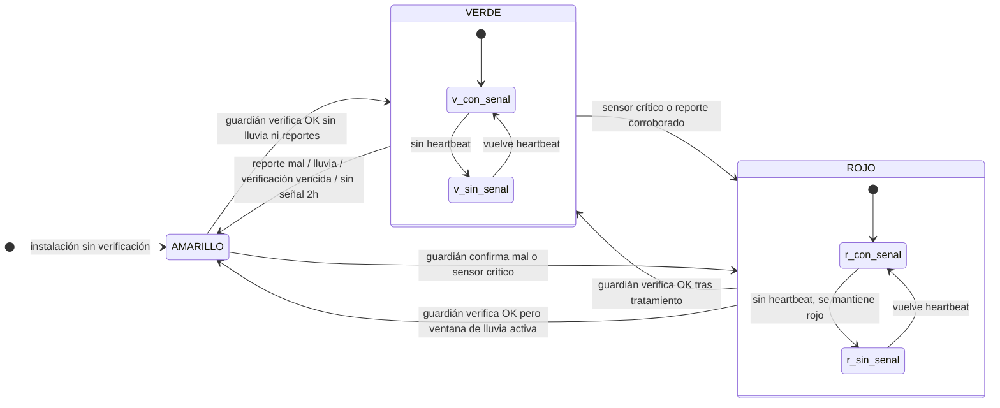

### 3.6 Diagrama de decisión del motor de reglas

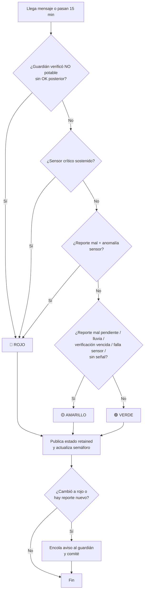

---

## 4. Flujos de personas

### 4.1 Poblador/a: buscar agua

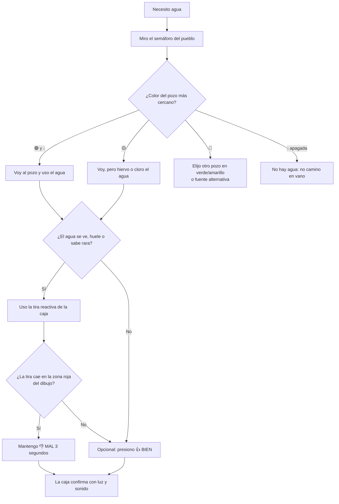

**Valor clave:** el semáforo está **en el pueblo**, así que la persona sabe el estado **antes de caminar** 4 a 6 km. Ahorra tiempo y reduce los trayectos innecesarios.

### 4.2 Guardián: visita semanal

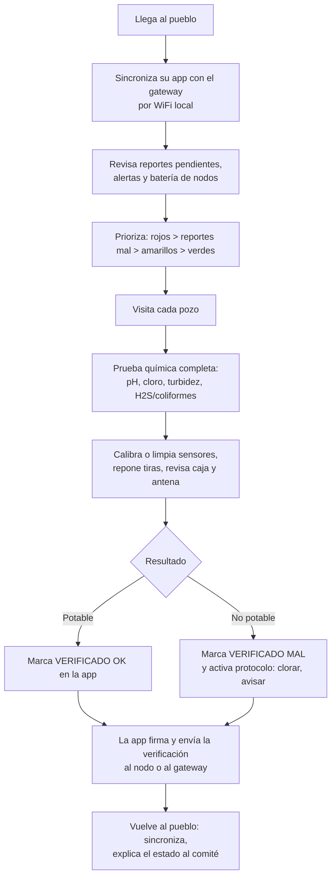

### 4.3 Recorrido emocional (User Journey)

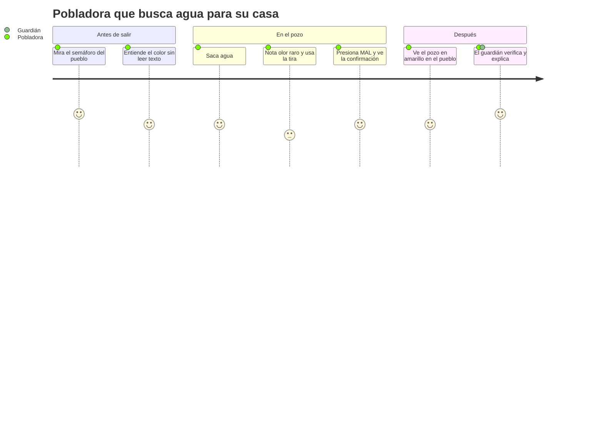

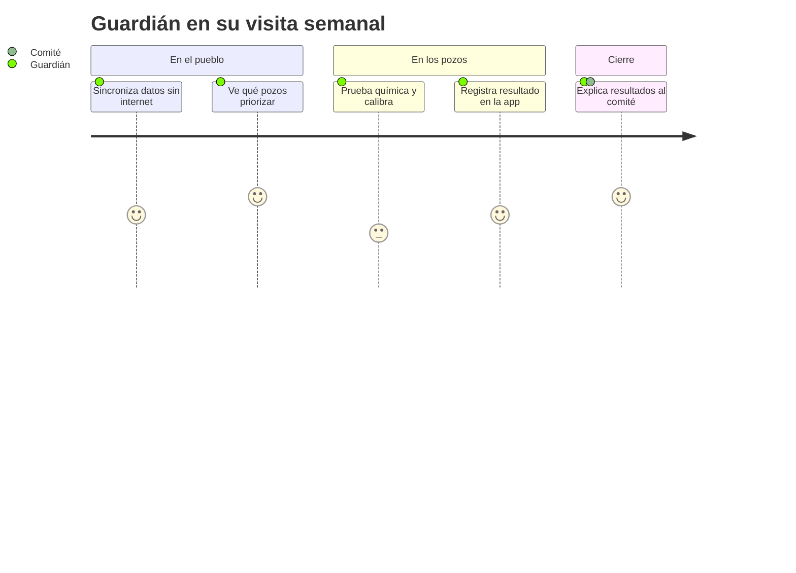

---

## 5. UI/UX

**Principios:** pictogramas antes que texto (alfabetización, idiomas locales), colores **con forma** (no depender solo del color, por el daltonismo), **retroalimentación siempre** (la persona tiene que saber que su reporte llegó) y **pocos elementos**.

### 5.1 Caja en el pozo

```
┌───────────────────────────────────────────┐
│          POZO 1  ·  [ícono pozo]          │
│                                           │
│   ¿Cómo está el agua?                     │
│                                           │
│   ┌─────────────┐     ┌─────────────┐     │
│   │     👍      │     │     👎      │     │
│   │   (verde)   │     │   (rojo)    │     │
│   │    BIEN     │     │    MAL      │     │
│   └─────────────┘     └─────────────┘     │
│        mantener presionado 3 segundos     │
│                                           │
│   Estado del envío:   ( ● )  LED          │
│                                           │
│   ┌─────────── Guía de la tira ─────────┐ │
│   │  [color] [color] │ [color] [color]  │ │
│   │     ✔ BIEN       │     ✖ MAL        │ │
│   └─────────────────────────────────────┘ │
│   [compartimento con tiras reactivas]     │
└───────────────────────────────────────────┘
```

| LED de la caja | Significado |
|---|---|
| Blanco parpadeando | Enviando… |
| Verde fijo 3 s + pitido corto | **Recibido por el pueblo** (llegó el ACK) |
| Naranja fijo 3 s | Guardado; se enviará apenas haya enlace |
| Rojo parpadeando (al presionar) | Ya hay un reporte reciente (cooldown), no se duplica |

**Decisiones de diseño:**
- **Mantener 3 segundos:** evita que un toque accidental o un juego de niños/as cuente como reporte.
- **Cooldown de 30 min por botón:** si se presiona varias veces cuenta como un solo reporte.
- Si están los recursos, la caja puede mostrar también el **estado actual del pozo** con un LED de color, como respaldo si el pueblo no tiene señal.

### 5.2 Semáforo en el pueblo (centro de control)

```
┌──────────────────────────────────────────────────┐
│               AGUA DE NUESTROS POZOS             │
│  ⛆ Lluvia reciente: hervir el agua (quedan 9 días)│
├───────────────┬──────────┬──────────┬────────────┤
│ Pozo          │ ¿Tomar?  │ ¿Hay?    │ Actualizado│
├───────────────┼──────────┼──────────┼────────────┤
│ Pozo 1 (6 km) │ 🟡 ▲      │ 💧        │ hace 10 min│
│ Pozo 2 (4 km) │ 🟢 ●      │ 💧        │ hace 5 min │
│ Pozo 3        │ 🔴 ■      │ ○ (sin)   │ ⚠ sin señal│
└───────────────┴──────────┴──────────┴────────────┘
   ● verde = tomar   ▲ amarillo = hervir   ■ rojo = NO
```

- Forma + color: ● círculo verde, ▲ triángulo amarillo, ■ cuadrado rojo.
- Puede ser un **panel físico de LEDs** (barato y robusto) en lugar de una pantalla.
- Leyenda con pictogramas (olla hirviendo = hervir, gota tachada = no tomar).

### 5.3 App del guardián (Android, 100 % offline)

```
┌─────────────────────────────┐
│ Pueblo San X  · Sincronizado│
├─────────────────────────────┤
│ ⚠ PRIORIDAD                 │
│  Pozo 3 · 🔴 sin señal 2 d  │
│  Pozo 1 · 👎 2 reportes      │
├─────────────────────────────┤
│ Pozo 2 · 🟢 · bat 82 %       │
│  Últ. verificación: 6 d     │
├─────────────────────────────┤
│ [ + Registrar verificación ]│
│ [ ⛆ Abrir ventana lluvia  ] │
│ [ ⇩ Exportar datos del mes ]│
└─────────────────────────────┘

Registrar verificación – Pozo 1
  pH:        [ 7.1 ]
  Turbidez:  [ 2.0 ] NTU
  Cloro:     [ 0.3 ] mg/L
  H2S:       ( ) Neg  ( ) Pos
  Resultado: (•) POTABLE ( ) NO POTABLE
  Nota:      [ animal cerca del pozo ]
  [ Firmar y guardar ]
```

---

## 6. Arquitectura

### 6.1 Cómo funcionan de verdad LoRa y MQTT (y la corrección clave)

**LoRa** es una **técnica de radio** (capa física): alcance largo, muy poca velocidad y muy poco consumo.

| Característica | Valor típico | Implicancia |
|---|---|---|
| Alcance | 2–5 km con obstáculos/vegetación; **10–20 km solo con línea de vista** y antenas en altura | Los 20 km de la pizarra son el caso ideal. **Con 4, 6 y 8 km hay que hacer una prueba de terreno.** |
| Velocidad | ~0,3 a ~5 kbps (según el *spreading factor*, SF7–SF12) | Mensajes de **pocos bytes** |
| Payload | ~11 a ~240 bytes según configuración | **JSON no conviene**: se usa binario compacto |
| Límites legales | Duty cycle 1 % (EU868) o *dwell time* de 400 ms por canal (US915/AU915, usados en América) | Limita cuántos mensajes y de qué tamaño se pueden enviar |
| Frecuencias | Bandas libres sub-GHz (915 MHz en la mayoría de América) | Sin licencia, sin costo de operador |

**MQTT** es un protocolo **pub/sub que funciona sobre TCP/IP**, es decir, sobre internet o una red local. **MQTT no viaja directamente sobre LoRa.** Por eso la arquitectura correcta es:

```
[Nodo pozo] --(radio LoRa, binario)--> [Gateway del pueblo] --(MQTT local)--> [Broker + motor de reglas]
```

El **gateway del pueblo** es el **puente**: recibe la radio LoRa, traduce el mensaje y lo publica en un **broker MQTT local** (por ejemplo, Mosquitto en una Raspberry Pi). Desde ahí todo es pub/sub, como estaba pensado.

Hay dos formas de montar el tramo LoRa:

| Opción | Cómo funciona | Ventajas | Desventajas |
|---|---|---|---|
| **LoRaWAN** (estándar) | Nodo → gateway → *network server* (p. ej. ChirpStack, que publica en MQTT de forma nativa) | Estándar, cifrado AES-128, ADR, ecosistema maduro | Los nodos **no se escuchan entre sí**: la replicación entre pozos se complica (existe la especificación de relay TS011, pero es más compleja) |
| **LoRa P2P + protocolo propio** (**recomendado para el prototipo**) | Cada nodo transmite su paquete; el gateway y los nodos vecinos escuchan | Permite **escucha pasiva y testigos** (sección 6.4); simple de prototipar con placas ESP32 + SX127x/SX126x | Hay que implementar ACK, reintentos y cifrado/MAC |

> Alternativas a mencionar: **MQTT-SN** (variante de MQTT pensada para redes sin TCP) y **Meshtastic** (malla LoRa ya hecha). Sirven como argumento de que el enfoque es viable con tecnología existente.

**¿Y la "garantía" de MQTT?** Los niveles QoS 0/1/2 de MQTT solo valen **entre el gateway y los suscriptores** (red local). En el tramo de radio la garantía la damos nosotros:
- **Número de secuencia (`seq`)** en cada mensaje: el gateway detecta los huecos (llegó el 41 y luego el 44 → faltan 42 y 43).
- **Buffer local en el nodo** (memoria flash o SD, circular): guarda las últimas N lecturas y las reenvía si el gateway pide los huecos o con el siguiente mensaje.
- **ACK solo para eventos importantes** (botón presionado, sensor crítico). La telemetría periódica va sin ACK porque cada respuesta consume tiempo de aire.
- **Deduplicación** por `(id_nodo, seq)`: si un mensaje llega dos veces (directo y por relevo), se guarda una sola vez. Es la misma idea del *idempotent producer* de Kafka.

### 6.2 Vista de componentes

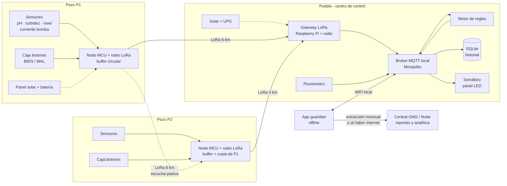

### 6.3 Vista de despliegue (UML Deployment, simplificado)

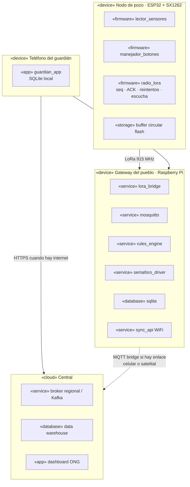

### 6.4 Replicación y testigos (el diferenciador de la arquitectura)

**La idea de Confluent/Kafka:** un dato no existe en un solo lugar. Si un broker cae, otra réplica tiene la información. Lo traducimos al terreno así:

| Copia | Dónde | Cómo llega |
|---|---|---|
| 1 | **Nodo del pozo** (buffer circular) | Al generarse |
| 2 | **Gateway del pueblo** (SQLite) | Uplink LoRa directo |
| 3 | **Pozo vecino** (P2 guarda un resumen de P1) | **Escucha pasiva**: LoRa es broadcast, así que si P2 está al alcance "oye" a P1 **sin gastar tiempo de aire extra** |
| 4 | **Teléfono del guardián** | Sincronización semanal |
| 5 | **Central / nube** | Extracción mensual o bridge |

**El testigo resuelve el caso crítico:** cuando el pueblo deja de oír a un pozo, ¿el pozo murió o solo se cortó el enlace? Cada nodo incluye en su heartbeat la lista de vecinos que oyó y cuándo.

| ¿El pueblo oye a P1? | ¿P2 dice que oye a P1? | ¿El pueblo oye a P2? | Diagnóstico | Acción |
|---|---|---|---|---|
| ✅ | — | — | Normal | — |
| ❌ | ✅ | ✅ | **P1 vivo, enlace P1→pueblo caído** (antena caída, obstrucción, animal) | P2 **retransmite** el estado de P1. El semáforo sigue funcionando con la etiqueta "vía relevo" |
| ❌ | ❌ | ✅ | **P1 caído** (energía, robo, animal, falla) | P1 pasa a "sin señal" y se encola una visita prioritaria del guardián |
| ❌ | ❌ | ❌ | **Falla del gateway del pueblo** | Alerta local en el centro de control y revisión de antena/energía |

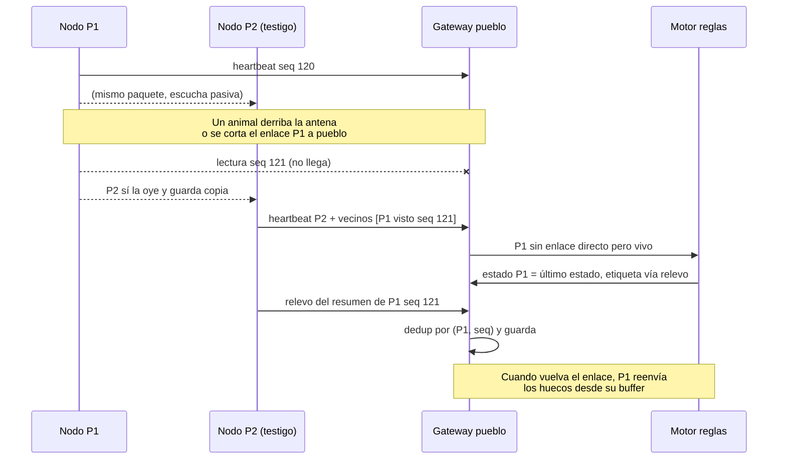

> ⚠️ **Detalle de topología a tener en cuenta:** el enlace P1↔P2 (8 km) es **el más largo** de los tres. Si P1 no llega al pueblo (6 km), es posible que tampoco llegue a P2. Opciones: (a) poner la antena del gateway en altura (torre de iglesia, estanque, cerro); (b) agregar un **repetidor** solar en un punto alto que vean todos los nodos; (c) validar los enlaces con una prueba de terreno antes de elegir. Esto demuestra que se pensó la física del problema y no solo el diagrama.

### 6.5 Secuencia: telemetría normal

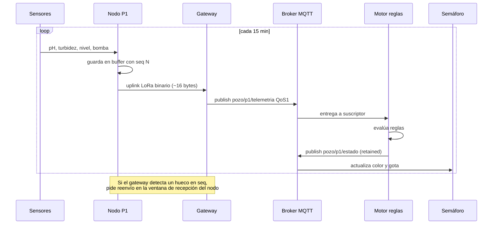

### 6.6 Secuencia: reporte comunitario y verificación

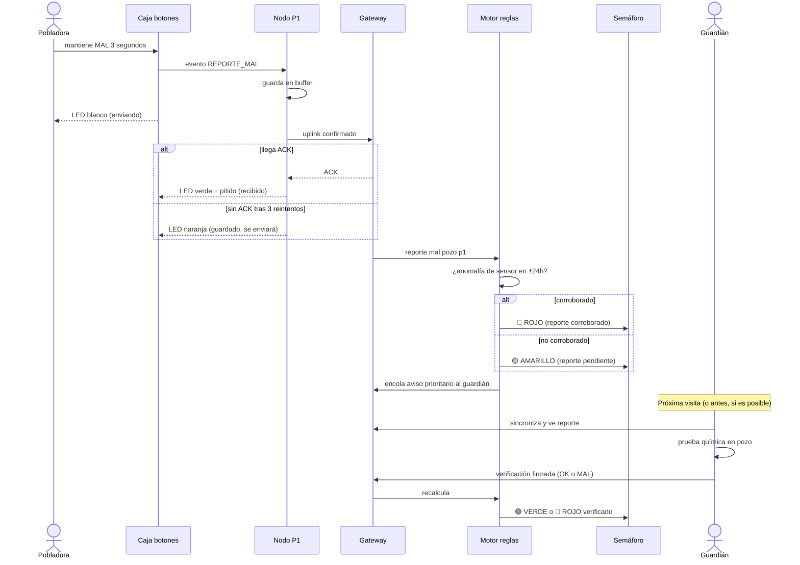

### 6.7 Secuencia: extracción de datos

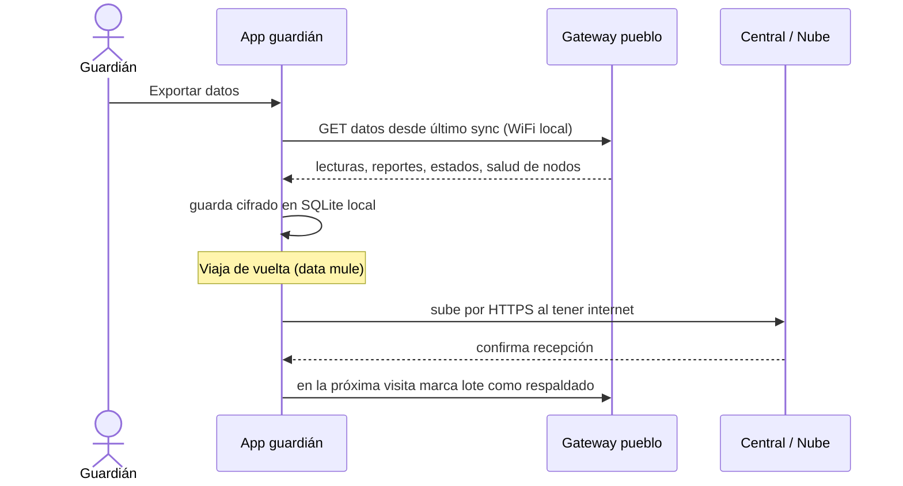

> **Sugerencia:** el guardián ya va **cada semana**. Conviene que la extracción sea **semanal y automática** al sincronizar su app, en vez de mensual. Es gratis (viaja igual) y reduce de 30 a 7 días la información que se podría perder si falla el gateway.

---

## 7. Modelo de datos

### 7.1 Ajustes respecto a la pizarra

| Pizarra | Propuesta | Por qué |
|---|---|---|
| `BOMBA_FUNCIONANDO` (BOOL) | Se mantiene | — |
| `VOLUMEN_POZO` (DECIMAL) | `nivel_agua_cm` (entero) | Un sensor ultrasónico o de presión mide **nivel**; el volumen se calcula con la geometría del pozo. Un entero ocupa menos bytes en radio. |
| ~~`VALOR_SENSOR`~~ (JSON?) | Campos explícitos: `ph`, `turbidez_ntu`, `conductividad`, `bateria` | JSON es demasiado grande para LoRa, y con campos explícitos se pueden aplicar reglas y validar. |
| `PERSONA_CONTAMINACION` (BOOL manual) | Entidad **`ReporteComunitario`** con `tipo = BIEN / MAL` | Hay que registrar **ambos** casos, con hora y secuencia. |
| `TIMESTAMP` | `ts_nodo` + `ts_recepcion` + `seq` | Los nodos pierden la hora (sin RTC o con deriva). El gateway sella la hora de recepción y el `seq` ordena. |
| `ID_POZO` (UUID4) | UUID4 en la base de datos + **`id_nodo` corto (1–2 bytes) en la radio** | Un UUID ocupa 16 bytes: demasiado para cada mensaje. Se mapea en el gateway. |
| — | `Verificacion`, `EventoLluvia`, `EstadoPozo`, `fuente`, `via` | Hacen falta para la lógica de verificación, lluvia y replicación. |

### 7.2 Diagrama de clases (UML)

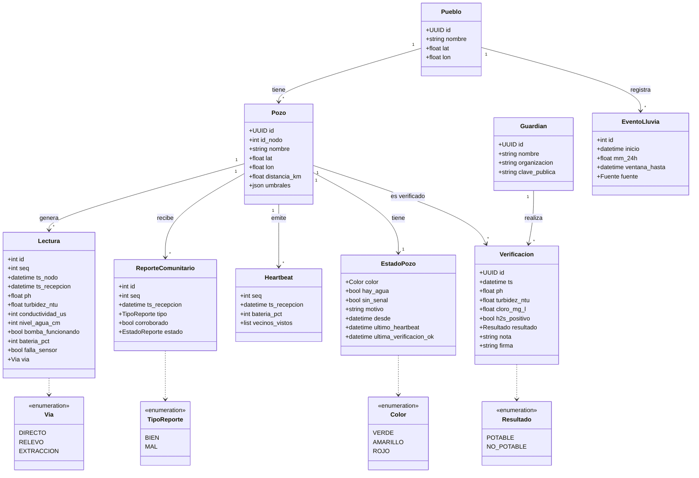

Restricción clave: **`UNIQUE(pozo_id, seq)`** en `Lectura`, `ReporteComunitario` y `Heartbeat`. Así la replicación nunca duplica datos.

### 7.3 Payload LoRa propuesto (binario, ~16 bytes)

| Byte(s) | Campo | Codificación |
|---|---|---|
| 0 | `id_nodo` | uint8 |
| 1 | `tipo_msg` | 0 = telemetría, 1 = heartbeat, 2 = botón, 3 = relevo, 4 = ACK |
| 2–3 | `seq` | uint16 |
| 4–5 | `ph` | uint16 × 100 (7,25 → 725) |
| 6–7 | `turbidez` | uint16 × 10 |
| 8–9 | `nivel_cm` | uint16 |
| 10 | `flags` | bit0 bomba · bit1 falla sensor · bit2 botón BIEN · bit3 botón MAL |
| 11 | `bateria_pct` | uint8 |
| 12–15 | `MAC` | 4 bytes (autenticación, evita mensajes falsos) |

Comparación: el mismo contenido en JSON pesa **~150 bytes**, unas 10 veces más tiempo de aire y de batería.

### 7.4 Tópicos MQTT (pueblo y niveles superiores)

```
{region}/{pueblo}/pozo/{id}/telemetria      QoS1
{region}/{pueblo}/pozo/{id}/heartbeat       QoS0
{region}/{pueblo}/pozo/{id}/reporte         QoS1
{region}/{pueblo}/pozo/{id}/verificacion    QoS1
{region}/{pueblo}/pozo/{id}/estado          QoS1, retained  ← el semáforo se suscribe aquí
{region}/{pueblo}/lluvia                    QoS1, retained
{region}/{pueblo}/gateway/salud             QoS0
```

`retained` en `estado` permite que cualquier suscriptor nuevo (un semáforo reiniciado, la app del guardián) reciba **de inmediato** el último estado conocido.

---

## 8. Casos borde (preparados para preguntas)

| Caso | Qué pasa | Cómo lo maneja el sistema |
|---|---|---|
| **Un animal rompe la antena o el cable** | El pueblo deja de oír al pozo | Testigo P2 + relevo (6.4). Si no hay testigo: "sin señal", verde → amarillo en 2 h y visita prioritaria. |
| **Un animal cae o muere en el pozo** (contaminación) | Agua contaminada sin cambio inmediato en sensores | Reporte comunitario (olor/color) + tira, posible corroboración por turbidez y verificación del guardián. Recomendar tapa y cerco del pozo. |
| **Niños/as jugando con los botones** | Reportes falsos | Mantener 3 s + cooldown 30 min. "MAL" solo pone amarillo (no rojo) salvo corroboración del sensor. "BIEN" nunca pone verde. |
| **Alguien presiona BIEN en un pozo contaminado** | Intento de ocultar el problema | "BIEN" no cambia el color: solo el guardián vuelve a verde. |
| **Reportes contradictorios** (BIEN y MAL el mismo día) | Ambigüedad | **MAL gana** (precaución). Se prioriza para el guardián. |
| **Batería baja** (días nublados) | El nodo puede apagarse | `bateria_pct` en cada heartbeat; bajo 20 % reduce la frecuencia de envío y avisa al guardián. |
| **Sensor sucio o descalibrado** (los de pH se degradan) | Lecturas erróneas | `falla_sensor` si los valores son imposibles o no cambian. **Calibración semanal** del guardián. Diferencias grandes entre sensor y kit → sensor marcado como no confiable. |
| **Cae el gateway del pueblo** (energía) | No se actualiza el semáforo | UPS + solar. Los nodos guardan en su buffer y reenvían. LED local en la caja del pozo como respaldo. |
| **Mensajes duplicados** (directo + relevo) | Datos repetidos | Deduplicación por `(id_nodo, seq)`. |
| **Hora incorrecta en el nodo** | Orden temporal erróneo | `ts_recepcion` del gateway + `seq`. El gateway sincroniza la hora del nodo en el ACK. |
| **Lluvia corta los caminos** y el guardián no llega (¡justo en la ventana crítica!) | Sin verificación | La ventana obliga a amarillo (hervir). La verificación vence y el pozo queda en amarillo. **El sistema falla hacia el lado seguro.** |
| **Robo o vandalismo** del panel o la batería | Nodo caído | Diagnóstico por testigo; montaje discreto y anclado; **apropiación comunitaria** (sección 10). |
| **Mensajes falsificados por radio** | Alguien envía "BIEN" falso | MAC con clave por nodo (LoRaWAN trae AES-128). Las verificaciones del guardián van firmadas. |
| **Bomba rota pero agua buena** | Confusión | Por eso potabilidad (color) y disponibilidad (gota) son indicadores separados. |
| **Todos los pozos en rojo** | La comunidad no tiene alternativa | **Protocolo de acción:** cloración/hervido, aviso a la ONG o municipio para un camión aljibe. El semáforo sin un protocolo de respuesta no sirve. |

---

## 9. Escalabilidad

El mismo patrón se repite por niveles: **cada nivel guarda y reenvía** (*store & forward*), igual que la replicación local.

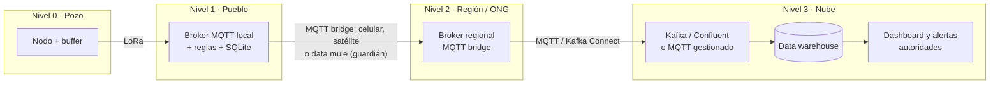

| Aspecto | Por qué escala |
|---|---|
| **Decisión en el borde** | Cada pueblo decide su semáforo solo. No depende de internet ni de la nube. Agregar 100 pueblos no carga a ninguno. |
| **Volumen de datos** | 1 pozo ≈ 96 mensajes/día × ~16 bytes ≈ **1,5 KB/día**. 1.000 pozos ≈ 1,5 MB/día. Insignificante para la nube. |
| **Capacidad de radio** | Un gateway LoRa atiende de cientos a miles de nodos con mensajes pequeños y poco frecuentes. El cuello de botella es el tiempo de aire, por eso el payload es mínimo. |
| **Tópicos jerárquicos** | `{region}/{pueblo}/...` permite suscribirse a un pozo, un pueblo o una región entera con comodines (`+`, `#`). |
| **Conectividad intermitente** | El bridge MQTT encola mientras no hay enlace y vacía la cola al reconectar. El *data mule* (guardián) sirve de respaldo. |
| **Valor agregado en la nube** | Correlación lluvia ↔ contaminación por zona, predicción de pozos en riesgo, planificación de visitas y reportes para financiadores y autoridades. |

---

## 10. Contexto cultural y de territorio: riesgos y mitigaciones

> ⚠️ **El país todavía no está definido.** Esta sección se basa en patrones comunes de zonas rurales (especialmente en Latinoamérica). Conviene validarla con información del lugar concreto.

| Riesgo | Detalle | Mitigación |
|---|---|---|
| **Alfabetización e idioma** | Puede haber baja lectoescritura o lenguas originarias | Pictogramas, colores con forma, cero texto obligatorio. Capacitación oral en la lengua local. |
| **Quién usa la solución** | El acarreo de agua suele recaer en **mujeres, niñas y niños** | Diseñar y probar con ellas (altura de la caja, simplicidad). Saber el estado **antes de caminar** reduce trayectos largos e innecesarios, que también son un factor de riesgo de seguridad personal (se conecta con el tema de violencia que apareció en la pizarra). |
| **Confianza en un agente externo** | Desconfianza hacia la ONG o hacia "aparatos de afuera" | Trabajar con el **comité de agua** local (JASS, CAPS, APR, según el país). El guardián explica cada cambio de color. Datos visibles para la comunidad. |
| **Apropiación** | "Si no es nuestro, no lo cuidamos" | Instalación participativa. Un encargado local del semáforo y de recargar tiras. Reconocimiento comunitario. |
| **Estigma por reportar** | Miedo a consecuencias o conflictos si se reporta agua mala | Reportes **anónimos** (el botón no identifica a nadie). Mensaje: reportar es cuidar. |
| **Fatiga de alertas** | En temporada de lluvias puede haber amarillo durante semanas | Mostrar los **días que quedan** de la ventana. Explicar por qué. Sin alarmas sonoras en el pueblo. |
| **Sin alternativa de agua** | El rojo no sirve si no hay otra fuente | Protocolo de respuesta (cloro, hervir, camión aljibe) acordado de antemano con el municipio o la ONG. |
| **Mantenimiento** | Baterías, tiras y sensores se agotan | Visita semanal del guardián + kit de repuestos + monitoreo de batería remoto. |
| **Vandalismo y robo** | Paneles y baterías tienen valor de reventa | Montaje en altura, anclado y discreto. La apropiación comunitaria es la mejor protección. |
| **Geografía** | Cerros y vegetación bloquean la radio | Prueba de terreno, antena en altura, repetidor. |
| **Clima** | Lluvia, inundaciones, calor sobre la electrónica | Caja IP67, sensores sumergibles, componentes de rango industrial. |

---

## 11. Revisión crítica de la arquitectura original

**Veredicto:** la arquitectura base es **sólida y defendible**. Las decisiones centrales están bien tomadas:

- ✅ **Lógica en el pueblo** (*edge computing*): el pozo solo informa y el pueblo decide. Las reglas se cambian en un solo lugar y funcionan sin internet.
- ✅ **Pub/sub** como columna vertebral: desacopla productores (pozos) de consumidores (semáforo, app, nube) y escala por niveles.
- ✅ **Replicación**: es el diferenciador. Responde a la pregunta "¿qué pasa si se cae la conexión?".
- ✅ **Heartbeat**: sin él no se distingue "todo bien" de "no llega nada".
- ✅ **Fallback offline**.

**Ajustes recomendados:**

| # | Ajuste | Motivo |
|---|---|---|
| 1 | **MQTT no viaja sobre LoRa**: agregar el **gateway como puente** LoRa → MQTT | Precisión técnica. Es probable que el jurado lo pregunte. |
| 2 | **Binario en vez de JSON** en la radio | Límites de payload y tiempo de aire de LoRa. |
| 3 | La replicación entre pozos se hace por **escucha pasiva + testigos**, no copiando todo (como un clúster Kafka) | La radio tiene muy poco ancho de banda. El broadcast de LoRa da la réplica "gratis". |
| 4 | La "garantía" se logra con **seq + buffer + ACK selectivo + deduplicación** | El QoS de MQTT no cubre el tramo de radio. |
| 5 | **SQLite en el gateway**, buffer circular en el nodo | Un microcontrolador alimentado por solar no es el lugar ideal para SQLite. |
| 6 | **Extracción semanal** junto con la visita del guardián | Ya va cada semana. Reduce el riesgo de perder datos. |
| 7 | **Validar los 20 km** con una prueba de terreno; ojo con el enlace de 8 km P1↔P2 | Los 20 km solo se logran con línea de vista. |
| 8 | **Separar potabilidad y disponibilidad** en el semáforo | Son problemas distintos con acciones distintas. |
| 9 | **Asimetría en la verificación**: solo el guardián pone verde | Resuelve el problema de verificar la información comunitaria. |

---

## 12. Preguntas probables del jurado (con respuesta corta)

1. **¿Cómo saben que lo que reporta la comunidad es verdad?**
   No lo asumimos. Un reporte "mal" solo activa precaución (amarillo). Pasa a rojo si un sensor lo corrobora o si el guardián lo verifica con kit. Volver a verde solo lo puede hacer el guardián con una verificación firmada.
2. **¿Y si se corta la comunicación?**
   Cada dato existe en varios lugares (nodo, gateway, vecino, teléfono del guardián, nube). Los pozos vecinos actúan como testigos y permiten distinguir "pozo caído" de "enlace caído" y retransmitir. Ante la duda el sistema falla hacia el lado seguro (amarillo, o se mantiene en rojo).
3. **¿Por qué LoRa y no celular?**
   No hay cobertura, no tiene costo mensual, consume muy poca energía (meses con una batería pequeña y un panel) y tiene kilómetros de alcance.
4. **¿Los sensores detectan heces o bacterias?**
   No directamente: nadie lo hace barato y en tiempo real. Usamos indicadores (turbidez, pH, conductividad), la regla preventiva de 15 días tras la lluvia y la verificación química del guardián.
5. **¿Cómo escala?**
   La decisión es local por pueblo y los niveles se conectan con pub/sub jerárquico y store & forward. El volumen de datos es mínimo (~1,5 KB por pozo al día).
6. **¿Qué pasa si un animal rompe el equipo?**
   El heartbeat detecta la caída en minutos, el testigo diagnostica si el pozo sigue vivo, el semáforo pasa a precaución y se prioriza la visita del guardián.
7. **¿Cuánto dura la batería?**
   Con mensajes de ~16 bytes cada 15 min y el MCU en sueño profundo, un panel pequeño y una batería de litio deberían cubrir la operación continua. *(Pendiente: calcularlo con el hardware concreto.)*

---

## 13. Pendientes y supuestos a validar

- [ ] Definir **país/región** y ajustar la sección 10 (lengua, comité de agua, banda LoRa legal).
- [ ] **Prueba de terreno** de los enlaces de radio (6, 4 y 8 km).
- [ ] Elegir los sensores concretos y calcular el **consumo energético** real.
- [ ] Calibrar los umbrales (pH, turbidez, mm de lluvia) con datos o literatura local.
- [ ] Definir el **protocolo de respuesta** ante rojo con el municipio o la ONG.
- [ ] Decidir LoRa P2P vs LoRaWAN para la versión productiva (P2P recomendado para el prototipo).
- [ ] Definir qué kit de prueba usa la comunidad y cuál el guardián.
